# ЗВІТ

про виконання лабораторної роботи № 1.3
«Середовище Microsoft Visual Studio»
з дисципліни «Алгоритмізація та програмування»
студента групи КН-2630б
**Турків Остап Миколайович**

---

## Умова завдання

Виконати в середовищі Microsoft Visual Studio / Visual C++ такі дії:

1. Налаштувати середовище: закрити, відкрити, перемістити та закріпити вікна Solution Explorer, Error List, Properties, Other Windows, Help.
2. Створити порожній проект Win32 Console Application з назвою PR1.
3. Додати порожній файл pr1.cpp.
4. Ввести код програми (див. [pr1.cpp](pr1.cpp), початкова версія з закоментованим `i++`).
5. Скомпілювати програму.
6. Встановити та вилучити точку переривання (звичайну та умовну).
7. Виконати програму покроково в режимі Debug, відобразити вікна перегляду змінних і стеку.
8. Причалити, відкріпити та з'єднати кілька вікон в одне вікно з закладками.
9. Визначити причину зациклення програми.
10. Виправити помилку та скомпілювати програму.
11. Запустити програму pr1.exe.
12. Продемонструвати роботу програми з точками переривання.
13. Встановити дві точки переривання.
14. Виконати трасування між двома точками переривання.
15. Знайти в тексті програми заданий рядок.
16. Замінити знайдений рядок на вказаний викладачем.

## Відповідь

Усі дії виконано у Visual Studio Community 2022 (17.14) у рішенні [AP_labs.sln](../AP_labs.sln), проект `Lab_1_3`. Скріни кожної дії наведено після таблиці (рис. 1–16).

| № | Дія | Як виконати у Visual Studio |
|---|-----|------------------------------|
| 1 | Налаштування вікон | Меню **View → Solution Explorer / Error List / Properties Window / Other Windows**. Вікно перетягується за заголовок; кнопка-«шпилька» закріплює або відкріплює його (Auto Hide). (рис. 1) |
| 2 | Створення проекту | **File → New → Project → Empty Project (C++)**; у рішенні проект має назву `Lab_1_3`. (рис. 2) |
| 3 | Додавання файлу | **Project → Add New Item → C++ File (.cpp)**, назва `pr1.cpp`. (рис. 3) |
| 4 | Введення коду | Ввести код із умови (з рядком `// i++;`). (рис. 4) |
| 5 | Компіляція | **Build → Build Solution** (Ctrl+Shift+B). У вікні Output: `Build: 1 succeeded`. (рис. 5) |
| 6 | Точка переривання | Клік на сірому полі зліва від рядка `p *= i;` (або F9) ставить червону точку, повторний клік її знімає. Умовна: наведення на точку → **Settings → Conditions** → вираз, наприклад `i == 1`. (рис. 6) |
| 7 | Покрокове виконання | **Debug → Start Debugging** (F5), далі **F10** (Step Over) / **F11** (Step Into). Вікна: **Debug → Windows → Locals / Watch / Call Stack**. (рис. 7) |
| 8 | Робота з вікнами | Перетягнути вікно на «ромб» докування; меню **Window → Float / Dock / Dock as Tabbed Document**. (рис. 8) |
| 9 | Причина зациклення | У вікні Locals видно, що `i` завжди дорівнює `1`: команда `i++` закоментована, тому умова `i <= 10` завжди істинна і цикл `while` нескінченний. (рис. 9) |
| 10 | Виправлення | Розкоментувати рядок: `i++;`, потім **Build → Rebuild Solution**. (рис. 10) |
| 11 | Запуск | **Debug → Start Without Debugging** (Ctrl+F5). Вивід: `Hello, World!` і `p = 3628800 i = 11`. (рис. 11) |
| 12 | Робота з точками переривання | F5: програма зупиняється на точці, значення змінних видно у вікні Locals. (рис. 12) |
| 13 | Дві точки переривання | Поставити точки на рядках `int p = 1;` та `cout << "p = " ...`. (рис. 13) |
| 14 | Трасування | F5 до першої точки, далі F10 по кроках до другої, стежачи за `p` та `i`. (рис. 14) |
| 15 | Пошук | **Edit → Find and Replace → Quick Find** (Ctrl+F), ввести рядок, наприклад `Hello`. (рис. 15) |
| 16 | Заміна | **Quick Replace** (Ctrl+H), ввести рядок-заміну, вказаний викладачем, → **Replace**. (рис. 16) |

### Скріни виконання дій

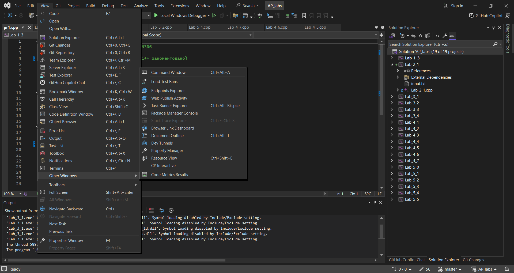

**Рис. 1. Меню View → Other Windows: відкриття вікон середовища**

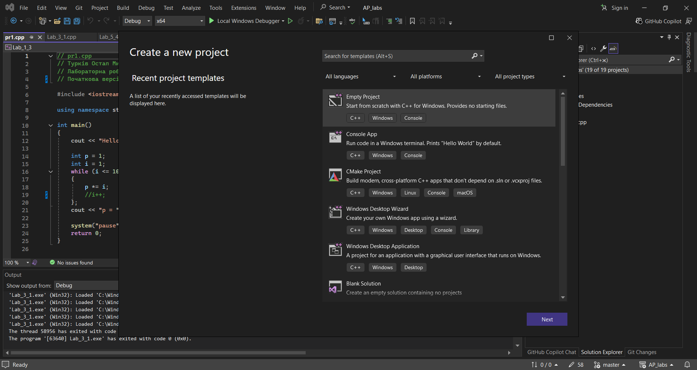

**Рис. 2. File → New → Project: шаблон Empty Project (C++)**

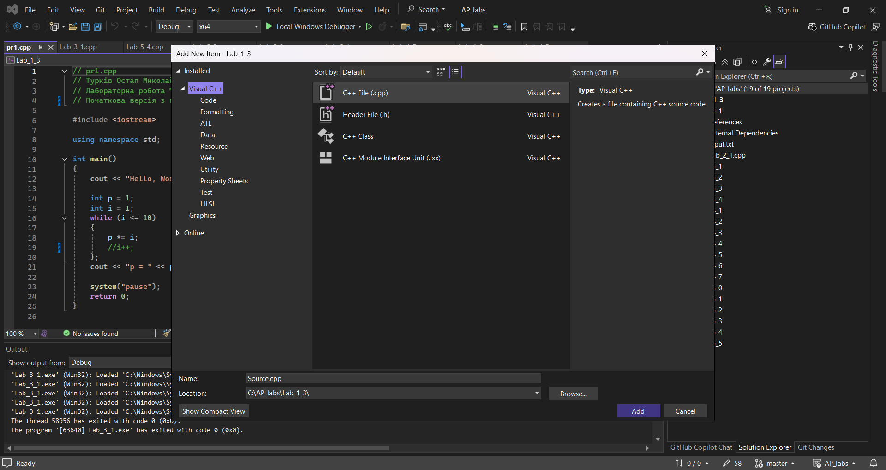

**Рис. 3. Project → Add New Item: C++ File (.cpp)**

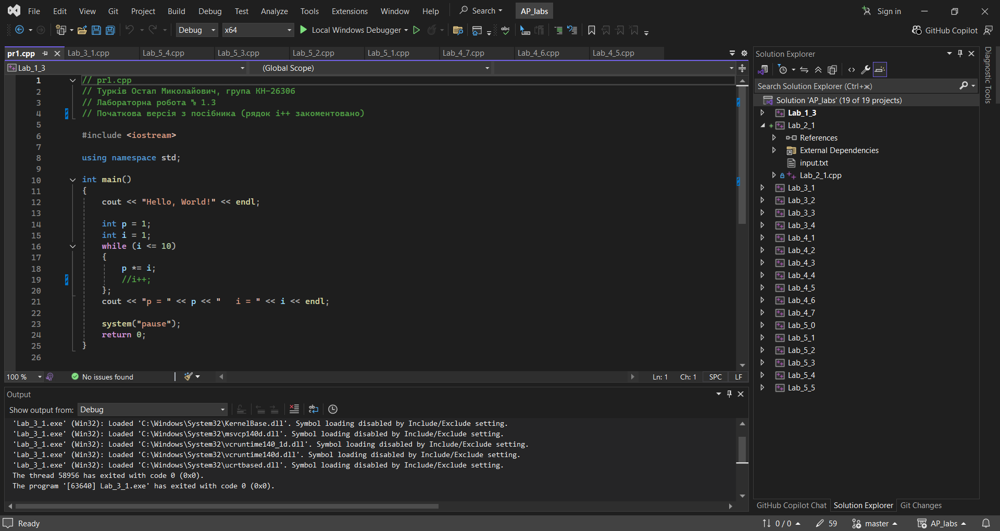

**Рис. 4. Текст програми pr1.cpp (початкова версія з //i++;)**

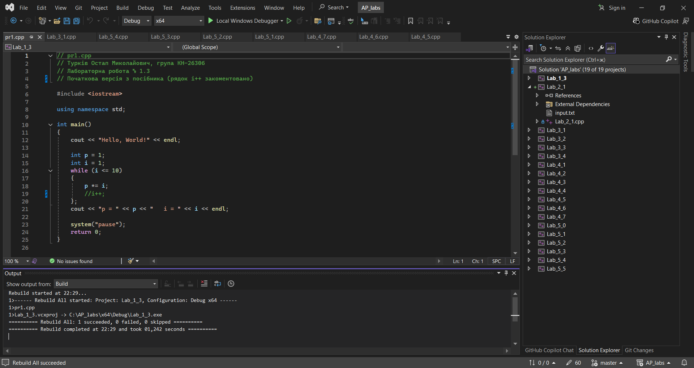

**Рис. 5. Build → Rebuild Lab_1_3: «Rebuild All: 1 succeeded, 0 failed»**

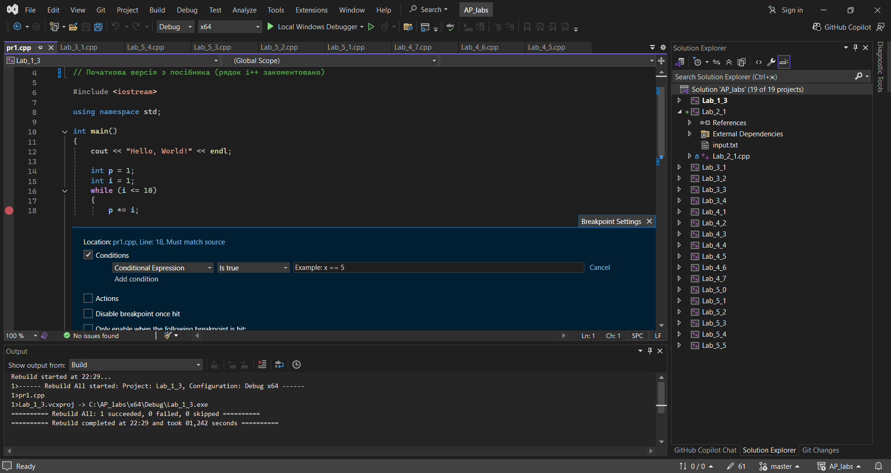

**Рис. 6. Точка переривання на рядку 18 і вікно Breakpoint Settings (Conditions)**

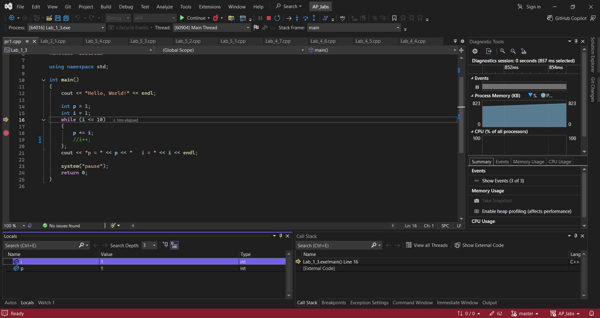

**Рис. 7. Покрокове виконання (Step Over), вікна Locals і Call Stack**

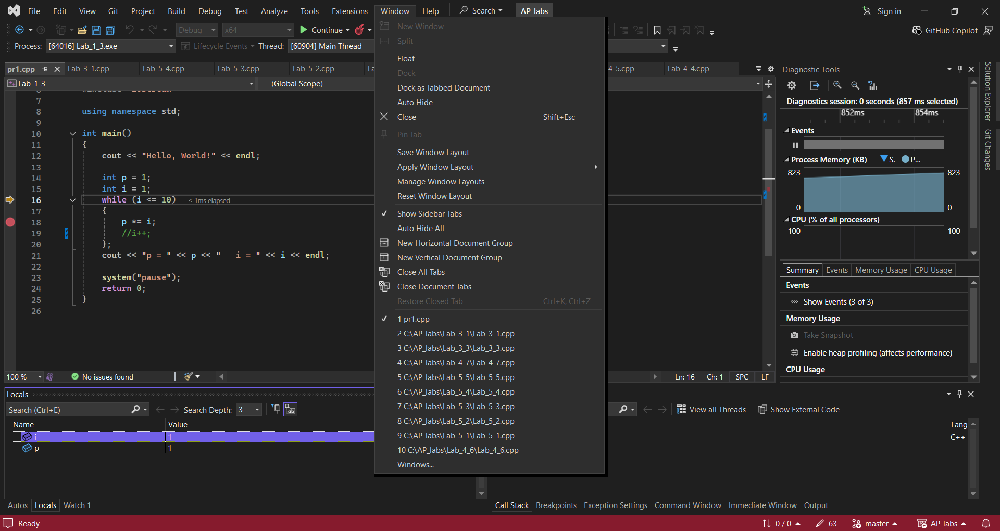

**Рис. 8. Меню Window: Float / Dock / Dock as Tabbed Document**

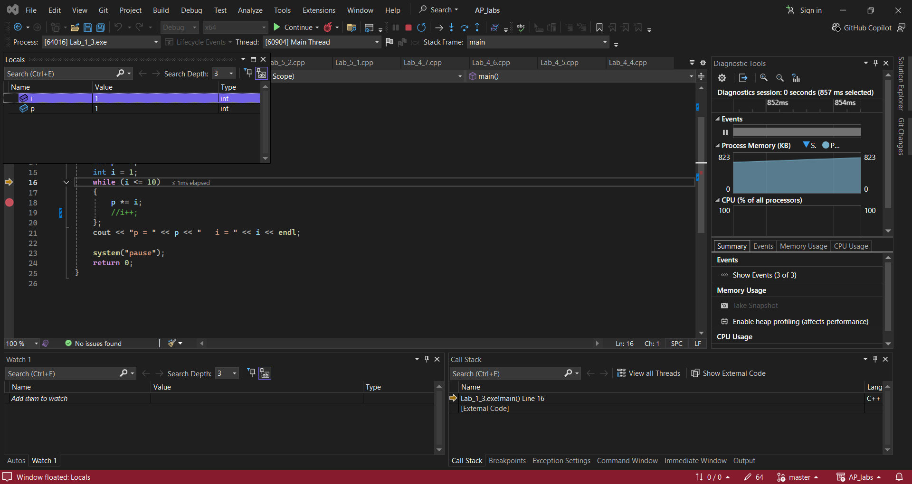

**Рис. 8а. Вікно Locals відкріплене (Float) і переміщене**

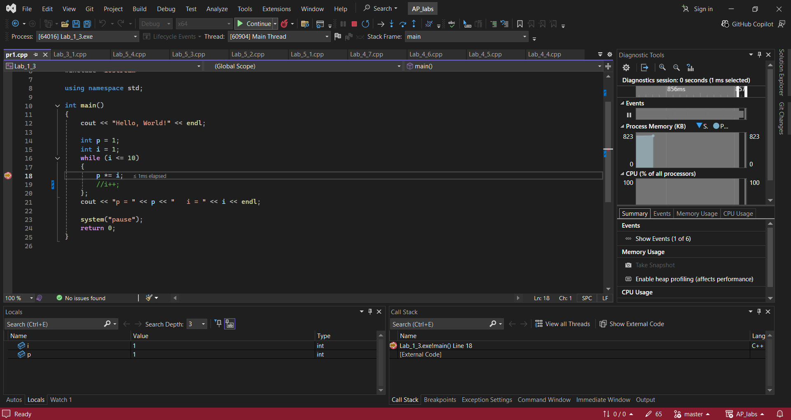

**Рис. 9. Після кількох Continue: i = 1, p = 1, тобто цикл не завершується**

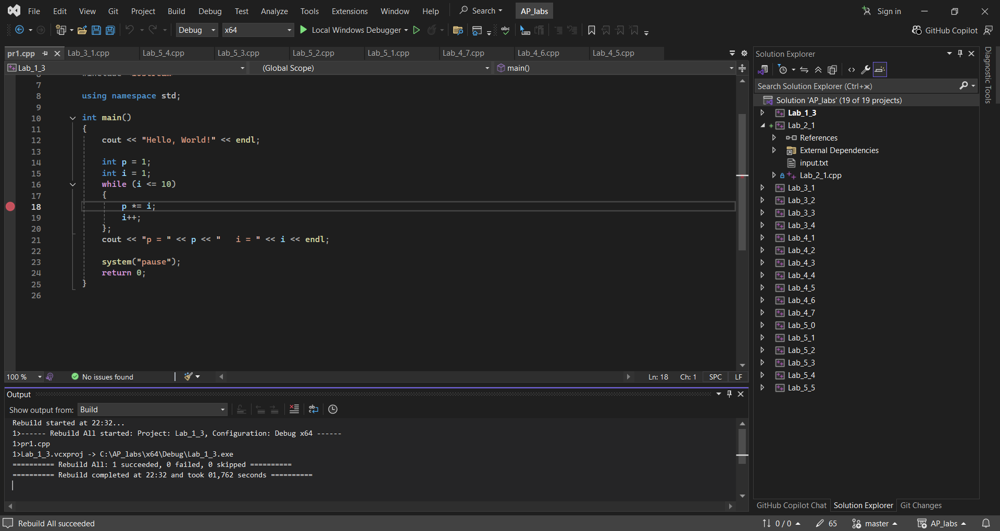

**Рис. 10. Виправлений код (i++;) і повторна компіляція: 1 succeeded**

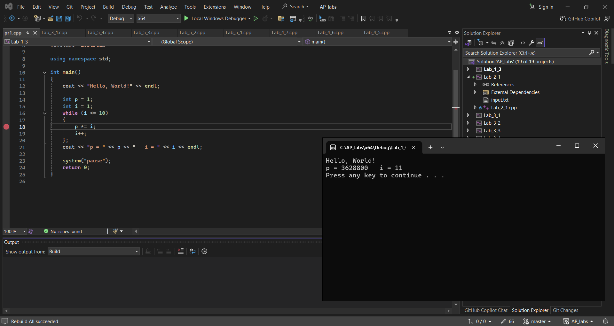

**Рис. 11. Запуск (Start Without Debugging): «Hello, World!», p = 3628800, i = 11**

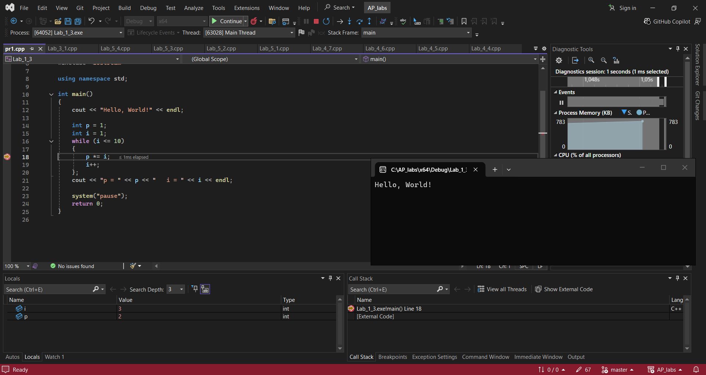

**Рис. 12. Зупинка на точці переривання, у Locals: i = 3, p = 2**

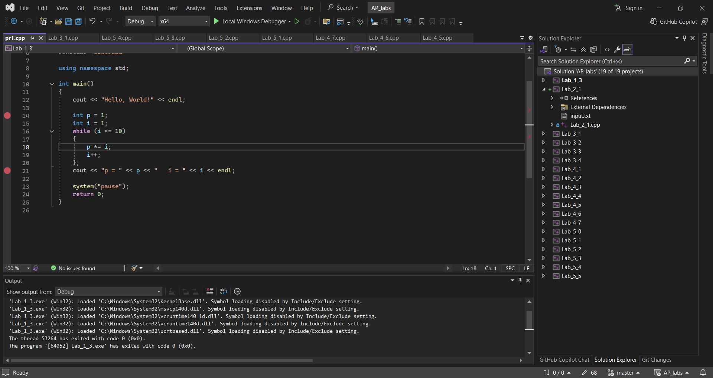

**Рис. 13. Дві точки переривання: рядки 14 і 21**

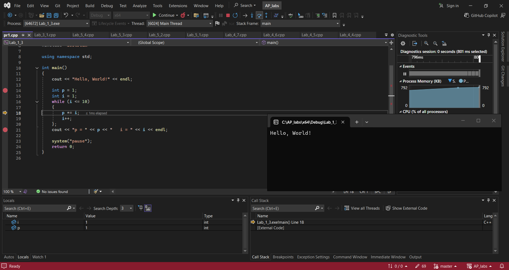

**Рис. 14. Трасування між точками переривання (Step Over)**

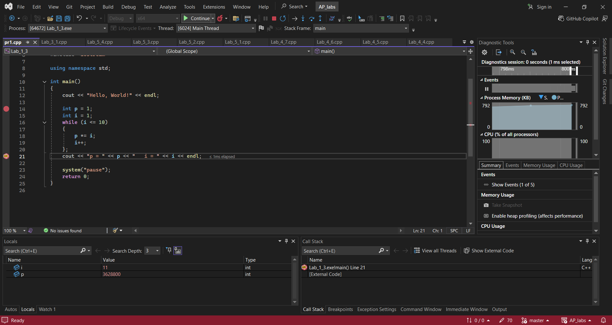

**Рис. 14а. Зупинка на другій точці переривання: p = 3628800, i = 11**

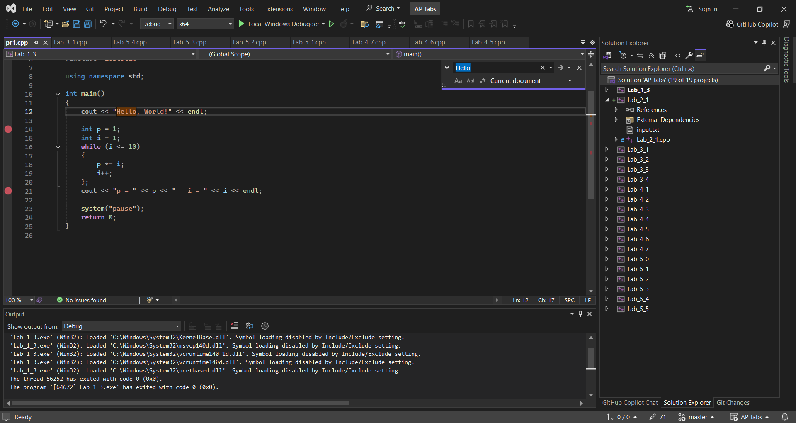

**Рис. 15. Edit → Find and Replace → Quick Find: знайдено рядок «Hello»**

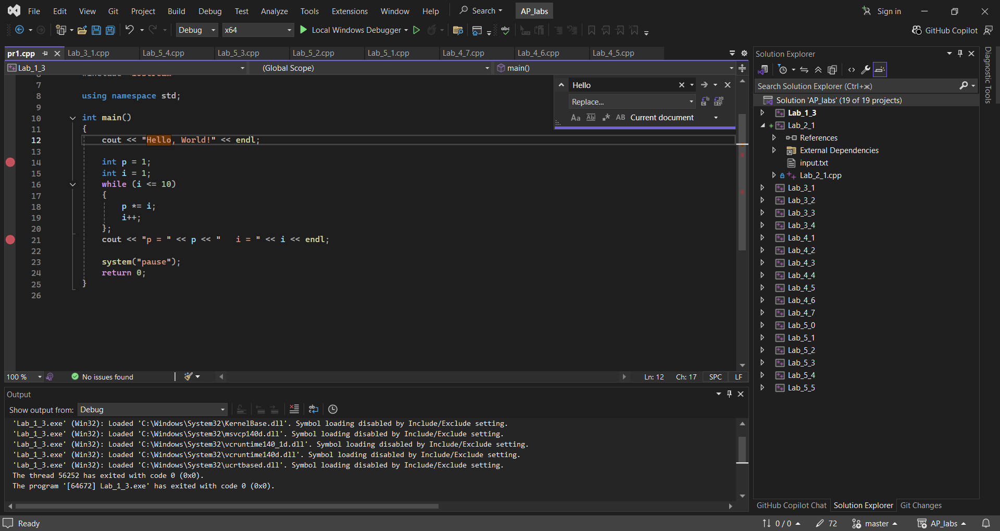

**Рис. 16. Quick Replace: панель заміни для рядка «Hello»; у поле Replace вводиться текст, заданий викладачем, далі кнопка Replace**

### Типові помилки

| Текст повідомлення системи | Що означає | Як виправити |
|---|---|---|
| `error C2065: 'cout': undeclared identifier` | ідентифікатор `cout` не оголошено | додати `#include <iostream>` і `using namespace std;` |
| `error C2143: syntax error: missing ';' before '}'` | пропущено крапку з комою перед `}` | поставити `;` в кінці попередньої команди |
| `error C3861: 'sqrt': identifier not found` | функцію `sqrt` не знайдено | додати `#include <cmath>` |
| `error C2059: syntax error: ')'` | синтаксична помилка, зайва або пропущена дужка | перевірити парність дужок |
| `LNK1168: cannot open PR1.exe for writing` | файл `.exe` ще запущений, і компонувальник не може його перезаписати | закрити вікно запущеної програми та перекомпілювати |

### Виправлений текст програми

Файл [pr1.cpp](pr1.cpp):

```cpp
// pr1.cpp
// Турків Остап Миколайович, група КН-2630б
// Лабораторна робота № 1.3
// Виправлена версія: розкоментовано i++ (причина зациклення)

#include <iostream>

using namespace std;

int main()
{
    cout << "Hello, World!" << endl;

    int p = 1;
    int i = 1;
    while (i <= 10)
    {
        p *= i;
        i++;
    };
    cout << "p = " << p << "   i = " << i << endl;

    system("pause");
    return 0;
}
```

## Висновки

У ході лабораторної роботи я ознайомився з середовищем Microsoft Visual Studio: навчився створювати консольний C++ проект, додавати файли, компілювати та запускати програму з налагодженням і без нього. Навчився ставити звичайні та умовні точки переривання, виконувати програму покроково і стежити за значеннями змінних. З їх допомогою знайшов причину зациклення: змінна циклу `i` не збільшувалась, бо команда `i++` була закоментована.
