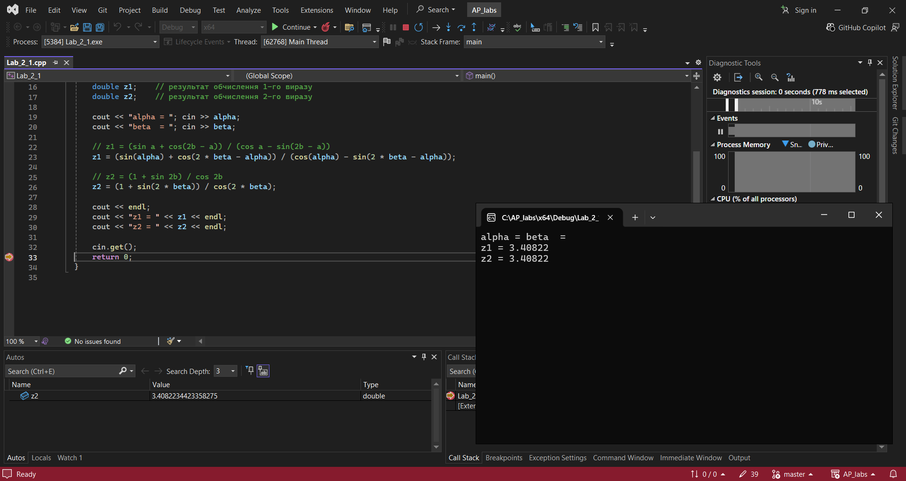

# ЗВІТ

про виконання лабораторної роботи № 2.1
«Лінійні програми»
з дисципліни «Алгоритмізація та програмування»
студента групи КН-2630б
**Турків Остап Миколайович**

---

## Умова завдання

Написати програму для розрахунку за двома формулами (результати обчислень за двома формулами мають збігатися).

**Варіант 33.**

```
       sin α + cos(2β − α)
z1 = ----------------------- ;
       cos α − sin(2β − α)

       1 + sin 2β
z2 = ------------- .
         cos 2β
```

## Алгоритм

1. Ввести значення α, β.
2. Обчислити значення z1.
3. Обчислити значення z2.
4. Вивести значення z1 та z2.

## Текст програми

Файл [Lab_2_1.cpp](Lab_2_1.cpp):

```cpp
// Lab_2_1.cpp
// Турків Остап Миколайович, група КН-2630б
// Лабораторна робота № 2.1
// Лінійні програми.
// Варіант 33

#include <iostream>
#include <cmath>

using namespace std;

int main()
{
    double alpha; // вхідний параметр (кут альфа, радіани)
    double beta;  // вхідний параметр (кут бета, радіани)
    double z1;    // результат обчислення 1-го виразу
    double z2;    // результат обчислення 2-го виразу

    cout << "alpha = "; cin >> alpha;
    cout << "beta  = "; cin >> beta;

    // z1 = (sin a + cos(2b - a)) / (cos a - sin(2b - a))
    z1 = (sin(alpha) + cos(2 * beta - alpha)) / (cos(alpha) - sin(2 * beta - alpha));

    // z2 = (1 + sin 2b) / cos 2b
    z2 = (1 + sin(2 * beta)) / cos(2 * beta);

    cout << endl;
    cout << "z1 = " << z1 << endl;
    cout << "z2 = " << z2 << endl;

    cin.get();
    return 0;
}
```

## Результати виконання програми

Програму скомпільовано та запущено у Visual Studio Community 2022 (конфігурація Debug | x64) командою **Debug → Start Debugging**. На рядку `return 0;` поставлено точку переривання, щоб вікно консолі з результатами залишалось відкритим. Вхідні дані: α = 1, β = 0.5. Вони подаються з файлу [input.txt](input.txt) (у властивостях проекту: Debugging → Command Arguments: `< input.txt`), тому у вікні консолі видно лише підказки введення, без самих значень.



**Рис. Виконання програми у Visual Studio 2022**

## Посилання на git-репозиторій з проектом

[https://github.com/ostapturkiv317-creator/AP_labs/tree/master/Lab_2_1](https://github.com/ostapturkiv317-creator/AP_labs/tree/master/Lab_2_1)

## Висновки

Я навчився створювати лінійні програми мовою C++: оголошувати змінні дійсного типу `double`, вводити дані з клавіатури (`cin`), обчислювати вирази зі стандартними математичними функціями з бібліотеки `<cmath>` (`sin`, `cos`) і виводити результат (`cout`). Обидві формули дають однаковий результат, бо `z2` — це спрощений вигляд виразу `z1` (тригонометрична тотожність). Це і підтверджує правильність запису виразів у програмі.
