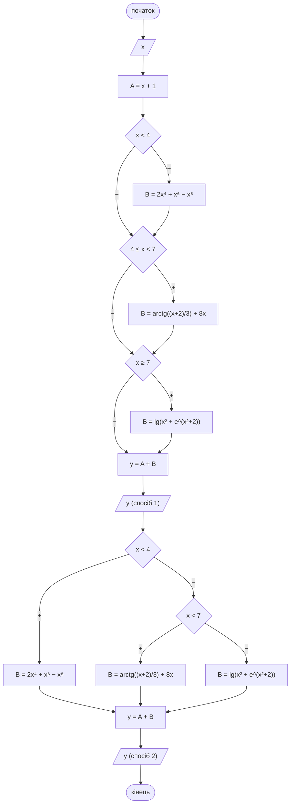

# ЗВІТ

про виконання лабораторної роботи № 3.1
«Розгалуження, задане формулою: функція однієї змінної»
з дисципліни «Алгоритмізація та програмування»
студента групи КН-2630б
**Турків Остап Миколайович**

---

## Умова завдання

Написати програму для обчислення і виводу на екран значення змінної y як функції від аргументу x (x, y — дійсні числа). Значення x ввести з клавіатури. В одній програмі реалізувати два способи: 1) лише команди розгалуження в скороченій формі; 2) лише команди розгалуження в повній формі. Отримані результати мають збігатися.

**Варіант 33.**

```
              | 2x⁴ + x⁶ − x⁸,           x < 4
y = x + 1 +   | arctg((x+2)/3) + 8x,     4 ≤ x < 7
              | lg(x² + e^(x²+2)),       x ≥ 7
```

## Блок-схема алгоритму



## UML-діаграма дії

```mermaid
flowchart TD
    S((" ")) --> IN("ввід x")
    IN --> A("A = x + 1")
    A --> M1{" "}
    M1 -->|"[x < 4]"| B1("B = 2x⁴ + x⁶ − x⁸")
    M1 -->|"[else]"| J1{" "}
    B1 --> J1
    J1 -->|"[4 ≤ x < 7]"| B2("B = arctg((x+2)/3) + 8x")
    J1 -->|"[else]"| J2{" "}
    B2 --> J2
    J2 -->|"[x ≥ 7]"| B3("B = lg(x² + e^(x²+2))")
    J2 -->|"[else]"| J3{" "}
    B3 --> J3
    J3 --> Y1("y = A + B")
    Y1 --> O1("вивід y")
    O1 --> K1{" "}
    K1 -->|"[x < 4]"| E1("B = 2x⁴ + x⁶ − x⁸")
    K1 -->|"[else]"| K2{" "}
    K2 -->|"[x < 7]"| E2("B = arctg((x+2)/3) + 8x")
    K2 -->|"[else]"| E3("B = lg(x² + e^(x²+2))")
    E1 --> J4{" "}
    E2 --> J4
    E3 --> J4
    J4 --> Y2("y = A + B")
    Y2 --> O2("вивід y")
    O2 --> F(((" ")))
    style S fill:#000
    style F fill:#000
```



## Текст програми

Файл [Lab_3_1.cpp](Lab_3_1.cpp):

```cpp
// Lab_3_1.cpp
// Турків Остап Миколайович, група КН-2630б
// Лабораторна робота № 3.1
// Розгалуження, задане формулою: функція однієї змінної.
// Варіант 33
//
//                  | 2x^4 + x^6 - x^8,              x < 4
// y = x + 1 +      | arctg((x+2)/3) + 8x,           4 <= x < 7
//                  | lg(x^2 + e^(x^2+2)),           x >= 7

#include <iostream>
#include <cmath>

using namespace std;

int main()
{
    double x; // вхідний аргумент
    double y; // результат обчислення виразу
    double A; // функціонально стала частина виразу
    double B; // функціонально змінна частина виразу

    cout << "x = "; cin >> x;

    A = x + 1;

    // спосіб 1: розгалуження в скороченій формі
    if (x < 4)
        B = 2 * pow(x, 4) + pow(x, 6) - pow(x, 8);
    if (4 <= x && x < 7)
        B = atan((x + 2) / 3) + 8 * x;
    if (x >= 7)
        B = log10(x * x + exp(x * x + 2));

    y = A + B;

    cout << endl;
    cout << "1) y = " << y << endl;

    // спосіб 2: розгалуження в повній формі
    if (x < 4)
        B = 2 * pow(x, 4) + pow(x, 6) - pow(x, 8);
    else
        if (x < 7)
            B = atan((x + 2) / 3) + 8 * x;
        else
            B = log10(x * x + exp(x * x + 2));

    y = A + B;

    cout << "2) y = " << y << endl;

    cin.get();
    return 0;
}
```

## Посилання на git-репозиторій з проектом

<!--REPO:Lab_3_1-->

## Висновки

Я навчився створювати розгалужені програми з командою `if` у скороченій (`if (...) ...;`) і повній (`if (...) ... else ...;`) формах. Скорочена форма перевіряє всі три умови окремо, тому умови мають взаємно виключати одна одну. Повна форма перевіряє умови по черзі, і кожна наступна перевірка виконується лише якщо попередня не справдилась, тому вона ефективніша. Обидва способи дають однаковий результат. Також навчився зображувати розгалуження на блок-схемах та UML-діаграмах дії.
