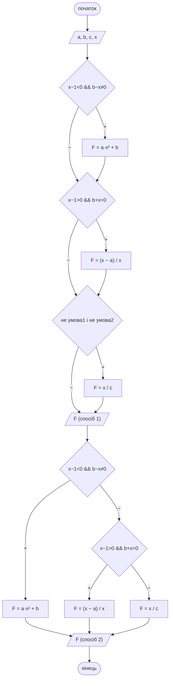

# ЗВІТ

про виконання лабораторної роботи № 3.2
«Розгалуження, задане формулою: функція з параметрами»
з дисципліни «Алгоритмізація та програмування»
студента групи КН-2630б
**Турків Остап Миколайович**

---

## Умова завдання

Написати програму для обчислення і виводу на екран значення функції F від аргументу x (a, b, c — дійсні числа). Значення a, b, c, x ввести з клавіатури. В одній програмі реалізувати два способи: 1) лише команди розгалуження в скороченій формі; 2) лише команди розгалуження в повній формі. Отримані результати мають збігатися.

**Варіант 33.**

```
     | a·x² + b,      при x − 1 < 0 і b − x ≠ 0
F =  | (x − a) / x,   при x − 1 > 0 і b + x = 0
     | x / c,         в інших випадках
```

## Блок-схема алгоритму



## UML-діаграма дії

```mermaid
flowchart TD
    S((" ")) --> IN("ввід a, b, c, x")
    IN --> M1{" "}
    M1 -->|"[x−1<0 && b−x≠0]"| F1("F = a·x² + b")
    M1 -->|"[else]"| J1{" "}
    F1 --> J1
    J1 -->|"[x−1>0 && b+x=0]"| F2("F = (x − a) / x")
    J1 -->|"[else]"| J2{" "}
    F2 --> J2
    J2 -->|"[!умова1 && !умова2]"| F3("F = x / c")
    J2 -->|"[else]"| J3{" "}
    F3 --> J3
    J3 --> O1("вивід F")
    O1 --> K1{" "}
    K1 -->|"[умова1]"| G1("F = a·x² + b")
    K1 -->|"[else]"| K2{" "}
    K2 -->|"[умова2]"| G2("F = (x − a) / x")
    K2 -->|"[else]"| G3("F = x / c")
    G1 --> J4{" "}
    G2 --> J4
    G3 --> J4
    J4 --> O2("вивід F")
    O2 --> E(((" ")))
    style S fill:#000
    style E fill:#000
```



## Текст програми

Файл [Lab_3_2.cpp](Lab_3_2.cpp):

```cpp
// Lab_3_2.cpp
// Турків Остап Миколайович, група КН-2630б
// Лабораторна робота № 3.2
// Розгалуження, задане формулою: функція з параметрами.
// Варіант 33
//
//      | a*x^2 + b,    при x - 1 < 0 і b - x != 0
// F =  | (x - a) / x,  при x - 1 > 0 і b + x == 0
//      | x / c,        в інших випадках

#include <iostream>

using namespace std;

int main()
{
    double x; // вхідний аргумент
    double a; // вхідний параметр
    double b; // вхідний параметр
    double c; // вхідний параметр
    double F; // результат обчислення виразу

    cout << "a = "; cin >> a;
    cout << "b = "; cin >> b;
    cout << "c = "; cin >> c;
    cout << "x = "; cin >> x;

    // спосіб 1: розгалуження в скороченій формі
    if (x - 1 < 0 && b - x != 0)
        F = a * x * x + b;
    if (x - 1 > 0 && b + x == 0)
        F = (x - a) / x;
    if (!(x - 1 < 0 && b - x != 0) && !(x - 1 > 0 && b + x == 0))
        F = x / c;

    cout << endl;
    cout << "1) F = " << F << endl;

    // спосіб 2: розгалуження в повній формі
    if (x - 1 < 0 && b - x != 0)
        F = a * x * x + b;
    else
        if (x - 1 > 0 && b + x == 0)
            F = (x - a) / x;
        else
            F = x / c;

    cout << "2) F = " << F << endl;

    cin.get();
    return 0;
}
```

## Посилання на git-репозиторій з проектом

[https://github.com/ostapturkiv317-creator/AP_labs/tree/master/Lab_3_2](https://github.com/ostapturkiv317-creator/AP_labs/tree/master/Lab_3_2)

## Висновки

Я навчився записувати складні умови розгалуження за допомогою логічних операцій `&&` (кон'юнкція), `||` (диз'юнкція), `!` (заперечення) та операцій відношення `<`, `>`, `==`, `!=`. У способі зі скороченою формою для гілки «в інших випадках» довелося явно записати заперечення обох попередніх умов. У повній формі ця гілка реалізується просто через `else`.
