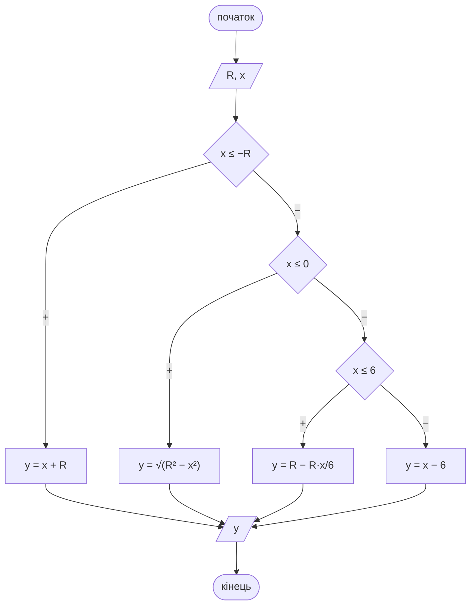
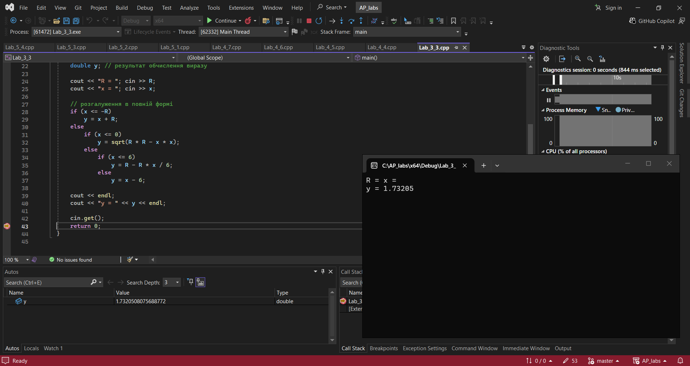

# ЗВІТ

про виконання лабораторної роботи № 3.3
«Розгалуження, задане графіком функції»
з дисципліни «Алгоритмізація та програмування»
студента групи КН-2630б
**Турків Остап Миколайович**

---

## Умова завдання

Написати програму, яка за введеним значенням аргументу обчислює значення функції, заданої у вигляді графіка. Параметр R вводиться з клавіатури.

**Варіант 33.** Графік складається з: прямої під кутом 45°, що приходить знизу зліва в точку (−R, 0); дуги кола радіуса R з центром у (0, 0) від (−R, 0) до (0, R); відрізка від (0, R) до (6, 0); прямої під кутом 45° вгору від точки (6, 0).

## Побудова математичної моделі

**Етап 1.** Графік складається з 4 функціонально різних елементів:

1. −∞ < x ≤ −R: пряма під кутом 45° через точку (−R, 0);
2. −R < x ≤ 0: верхня дуга кола радіуса R з центром (0, 0);
3. 0 < x ≤ 6: пряма через точки (0, R) та (6, 0);
4. 6 < x < ∞: пряма під кутом 45° через точку (6, 0).

**Етап 2.** Рівняння елементів:

1. tg 45° = 1, отже y = x + b; з умови 0 = −R + b маємо b = R, тобто **y = x + R**.
2. x² + y² = R², верхня дуга (знак «+»): **y = √(R² − x²)**.
3. За рівнянням прямої через дві точки (x₁, y₁) = (0, R), (x₂, y₂) = (6, 0):
   y = y₁ + (y₂ − y₁)/(x₂ − x₁)·(x − x₁) = R + (0 − R)/6 · x, тобто **y = R − R·x/6**.
4. y = x + b, з умови 0 = 6 + b маємо b = −6, тобто **y = x − 6**.

**Етап 3.** Формула з 4 гілками:

```
     | x + R,              x ≤ −R
y =  | √(R² − x²),         −R < x ≤ 0
     | R − R·x/6,          0 < x ≤ 6
     | x − 6,              x > 6
```

## Блок-схема алгоритму



## UML-діаграма дії

```mermaid
flowchart TD
    S((" ")) --> IN("ввід R, x")
    IN --> D1{" "}
    D1 -->|"[x ≤ −R]"| Y1("y = x + R")
    D1 -->|"[else]"| D2{" "}
    D2 -->|"[x ≤ 0]"| Y2("y = √(R² − x²)")
    D2 -->|"[else]"| D3{" "}
    D3 -->|"[x ≤ 6]"| Y3("y = R − R·x/6")
    D3 -->|"[else]"| Y4("y = x − 6")
    Y1 --> J{" "}
    Y2 --> J
    Y3 --> J
    Y4 --> J
    J --> O("вивід y")
    O --> E(((" ")))
    style S fill:#000
    style E fill:#000
```



## Текст програми

Файл [Lab_3_3.cpp](Lab_3_3.cpp):

```cpp
// Lab_3_3.cpp
// Турків Остап Миколайович, група КН-2630б
// Лабораторна робота № 3.3
// Розгалуження, задане графіком функції.
// Варіант 33
//
// Математична модель (з графіка):
//      | x + R,             x <= -R        (пряма під кутом 45° через (-R, 0))
//  y = | sqrt(R^2 - x^2),   -R < x <= 0    (верхня дуга кола радіуса R з центром (0, 0))
//      | R - R*x/6,         0 < x <= 6     (пряма через (0, R) та (6, 0))
//      | x - 6,             x > 6          (пряма під кутом 45° через (6, 0))

#include <iostream>
#include <cmath>

using namespace std;

int main()
{
    double x; // вхідний аргумент
    double R; // вхідний параметр (радіус)
    double y; // результат обчислення виразу

    cout << "R = "; cin >> R;
    cout << "x = "; cin >> x;

    // розгалуження в повній формі
    if (x <= -R)
        y = x + R;
    else
        if (x <= 0)
            y = sqrt(R * R - x * x);
        else
            if (x <= 6)
                y = R - R * x / 6;
            else
                y = x - 6;

    cout << endl;
    cout << "y = " << y << endl;

    cin.get();
    return 0;
}
```

## Результати виконання програми

Програму скомпільовано та запущено у Visual Studio Community 2022 (конфігурація Debug | x64) командою **Debug → Start Debugging**. На рядку `return 0;` поставлено точку переривання, щоб вікно консолі з результатами залишалось відкритим. Вхідні дані: R = 2, x = −1. Вони подаються з файлу [input.txt](input.txt) (у властивостях проекту: Debugging → Command Arguments: `< input.txt`), тому у вікні консолі видно лише підказки введення, без самих значень.



**Рис. Виконання програми у Visual Studio 2022**

## Посилання на git-репозиторій з проектом

[https://github.com/ostapturkiv317-creator/AP_labs/tree/master/Lab_3_3](https://github.com/ostapturkiv317-creator/AP_labs/tree/master/Lab_3_3)

## Висновки

Я навчився будувати математичну модель функції, заданої графіком: розбивати графік на функціонально різні ділянки та виводити для кожної рівняння (пряма через дві точки, пряма під заданим кутом, дуга кола). Розгалуження реалізоване в повній формі `if ... else if ...`, тому кожна наступна умова перевіряє лише праву межу інтервалу: ліва межа вже гарантується тим, що попередня умова не виконалась.
