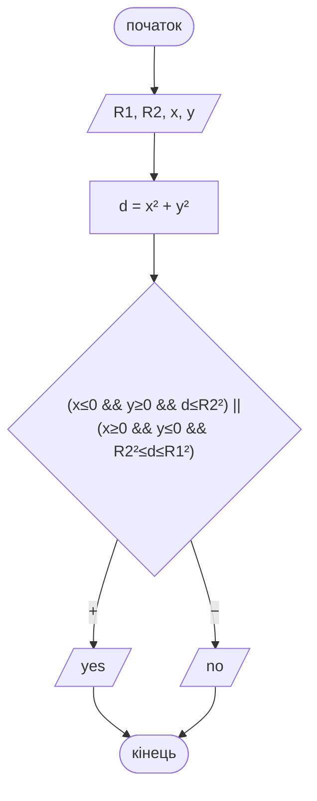
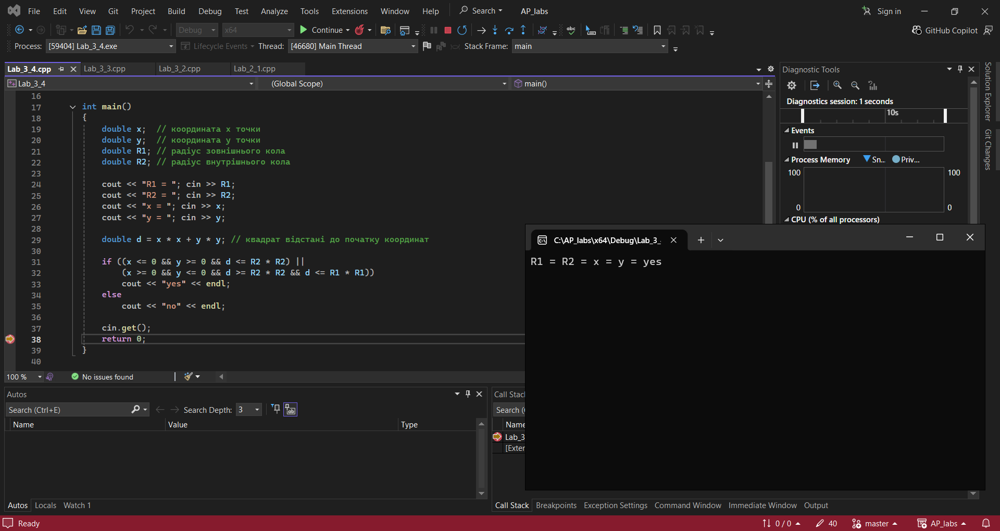

# ЗВІТ

про виконання лабораторної роботи № 3.4
«Розгалуження, задане плоскою фігурою»
з дисципліни «Алгоритмізація та програмування»
студента групи КН-2630б
**Турків Остап Миколайович**

---

## Умова завдання

Написати програму, яка визначає, чи попадає точка з заданими координатами в область, зафарбовану на рисунку сірим кольором. Результат вивести у вигляді текстового повідомлення. Параметри R₁, R₂ вводяться з клавіатури.

**Варіант 33.** На рисунку зображено два концентричні кола з центром у (0, 0): внутрішнє радіуса R₂ і зовнішнє радіуса R₁ (R₁ > R₂). Зафарбовано: верхню ліву чверть круга радіуса R₂, а також частину кільця між колами R₂ і R₁ у нижній правій чверті.

## Побудова математичної моделі

**Етап 1.** Область складається з двох незв'язних частин A і B.

**Етап 2.**

- **A**, чверть круга радіуса R₂ у II чверті: `x ≤ 0` і `y ≥ 0` і `x² + y² ≤ R₂²`;
- **B**, частина кільця у IV чверті: `x ≥ 0` і `y ≤ 0` і `x² + y² ≥ R₂²` і `x² + y² ≤ R₁²`.

**Етап 3.** Точка належить області, якщо `A або B`:

```
(x ≤ 0 && y ≥ 0 && x²+y² ≤ R2²) || (x ≥ 0 && y ≤ 0 && x²+y² ≥ R2² && x²+y² ≤ R1²)
```

## Блок-схема алгоритму



## UML-діаграма дії

```mermaid
flowchart TD
    S((" ")) --> IN("ввід R1, R2, x, y")
    IN --> D("d = x² + y²")
    D --> C{" "}
    C -->|"[A або B]"| Y("вивід yes")
    C -->|"[else]"| N("вивід no")
    Y --> J{" "}
    N --> J
    J --> E(((" ")))
    style S fill:#000
    style E fill:#000
```



## Текст програми

Файл [Lab_3_4.cpp](Lab_3_4.cpp):

```cpp
// Lab_3_4.cpp
// Турків Остап Миколайович, група КН-2630б
// Лабораторна робота № 3.4
// Розгалуження, задане плоскою фігурою.
// Варіант 33
//
// Область (з рисунка) складається з двох частин:
//  A: верхня ліва чверть круга радіуса R2:
//       x <= 0, y >= 0, x^2 + y^2 <= R2^2
//  B: частина кільця між колами R2 та R1 у нижній правій чверті:
//       x >= 0, y <= 0, R2^2 <= x^2 + y^2 <= R1^2

#include <iostream>

using namespace std;

int main()
{
    double x;  // координата x точки
    double y;  // координата y точки
    double R1; // радіус зовнішнього кола
    double R2; // радіус внутрішнього кола

    cout << "R1 = "; cin >> R1;
    cout << "R2 = "; cin >> R2;
    cout << "x = "; cin >> x;
    cout << "y = "; cin >> y;

    double d = x * x + y * y; // квадрат відстані до початку координат

    if ((x <= 0 && y >= 0 && d <= R2 * R2) ||
        (x >= 0 && y <= 0 && d >= R2 * R2 && d <= R1 * R1))
        cout << "yes" << endl;
    else
        cout << "no" << endl;

    cin.get();
    return 0;
}
```

## Результати виконання програми

Програму скомпільовано та запущено у Visual Studio Community 2022 (конфігурація Debug | x64) командою **Debug → Start Debugging**. На рядку `return 0;` поставлено точку переривання, щоб вікно консолі з результатами залишалось відкритим. Вхідні дані: R1 = 3, R2 = 2, x = −1, y = 1. Вони подаються з файлу [input.txt](input.txt) (у властивостях проекту: Debugging → Command Arguments: `< input.txt`), тому у вікні консолі видно лише підказки введення, без самих значень.



**Рис. Виконання програми у Visual Studio 2022**

## Посилання на git-репозиторій з проектом

[https://github.com/ostapturkiv317-creator/AP_labs/tree/master/Lab_3_4](https://github.com/ostapturkiv317-creator/AP_labs/tree/master/Lab_3_4)

## Висновки

Я навчився описувати плоску фігуру системою нерівностей: внутрішня частина круга задається як `x² + y² ≤ R²`, зовнішня як `x² + y² ≥ R²`, чверть координатної площини задається знаками x та y. Перетин областей записується через логічне «і» (`&&`), а об'єднання незв'язних частин через логічне «або» (`||`).
