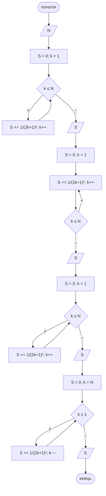

# ЗВІТ

про виконання лабораторної роботи № 4.1
«Цикли»
з дисципліни «Алгоритмізація та програмування»
студента групи КН-2630б
**Турків Остап Миколайович**

---

## Умова завдання

Написати програму, яка обчислює значення вказаного виразу за допомогою циклів. В одній програмі вивести результати обчислень чотирма способами: 1) `while(…) {…}`; 2) `do {…} while(…);`; 3) `for(…; …; n++) {…}`; 4) `for(…; …; n--) {…}`. Усі 4 результати мають збігатися.

**Варіант 33.**

```
       N        1
S =   Σ    ----------
      k=1   (2k + 1)²
```

## Блок-схема алгоритму



## UML-діаграма дії

```mermaid
flowchart TD
    S0((" ")) --> IN("ввід N")
    IN --> A1("S = 0; k = 1")
    A1 --> M1{" "}
    M1 --> W1{" "}
    W1 -->|"[k ≤ N]"| B1("S += 1/(2k+1)²")
    B1 --> I1("k++")
    I1 --> M1
    W1 -->|"[else]"| O1("вивід S")
    O1 --> A2("S = 0; k = 1")
    A2 --> M2{" "}
    M2 --> B2("S += 1/(2k+1)²")
    B2 --> I2("k++")
    I2 --> W2{" "}
    W2 -->|"[k ≤ N]"| M2
    W2 -->|"[else]"| O2("вивід S")
    O2 --> A3("S = 0; k = 1 (for k++)")
    A3 --> M3{" "}
    M3 --> W3{" "}
    W3 -->|"[k ≤ N]"| B3("S += 1/(2k+1)²")
    B3 --> I3("k++")
    I3 --> M3
    W3 -->|"[else]"| O3("вивід S")
    O3 --> A4("S = 0; k = N (for k−−)")
    A4 --> M4{" "}
    M4 --> W4{" "}
    W4 -->|"[k ≥ 1]"| B4("S += 1/(2k+1)²")
    B4 --> I4("k−−")
    I4 --> M4
    W4 -->|"[else]"| O4("вивід S")
    O4 --> E(((" ")))
    style S0 fill:#000
    style E fill:#000
```



## Текст програми

Файл [Lab_4_1.cpp](Lab_4_1.cpp):

```cpp
// Lab_4_1.cpp
// Турків Остап Миколайович, група КН-2630б
// Лабораторна робота № 4.1
// Цикли.
// Варіант 33
//
// S = sum_{k=1}^{N} 1 / (2k + 1)^2

#include <iostream>

using namespace std;

int main()
{
    int N;    // верхня межа суми
    int k;    // параметр циклу
    double S; // сума

    cout << "N = "; cin >> N;

    // 1) while
    S = 0;
    k = 1;
    while (k <= N)
    {
        S += 1.0 / ((2 * k + 1) * (2 * k + 1));
        k++;
    }
    cout << "1) while       S = " << S << endl;

    // 2) do ... while
    S = 0;
    k = 1;
    do {
        S += 1.0 / ((2 * k + 1) * (2 * k + 1));
        k++;
    } while (k <= N);
    cout << "2) do...while  S = " << S << endl;

    // 3) for (k++)
    S = 0;
    for (k = 1; k <= N; k++)
    {
        S += 1.0 / ((2 * k + 1) * (2 * k + 1));
    }
    cout << "3) for k++     S = " << S << endl;

    // 4) for (k--)
    S = 0;
    for (k = N; k >= 1; k--)
    {
        S += 1.0 / ((2 * k + 1) * (2 * k + 1));
    }
    cout << "4) for k--     S = " << S << endl;

    return 0;
}
```

## Посилання на git-репозиторій з проектом

[https://github.com/ostapturkiv317-creator/AP_labs/tree/master/Lab_4_1](https://github.com/ostapturkiv317-creator/AP_labs/tree/master/Lab_4_1)

## Висновки

Я навчився використовувати три команди циклів C++: `while` (цикл «поки» з передумовою), `do…while` (цикл «поки» з післяумовою, який виконується хоча б один раз) та `for` (компактний запис циклу з передумовою, ініціалізацією та модифікацією). Сума обчислюється за загальною схемою: `S = 0`, далі в циклі `S += a`. Порядок додавання (k++ чи k−−) не впливає на результат, тому всі 4 способи дають однакову суму. При обчисленні дробу використано `1.0`, щоб уникнути цілочисельного ділення.
