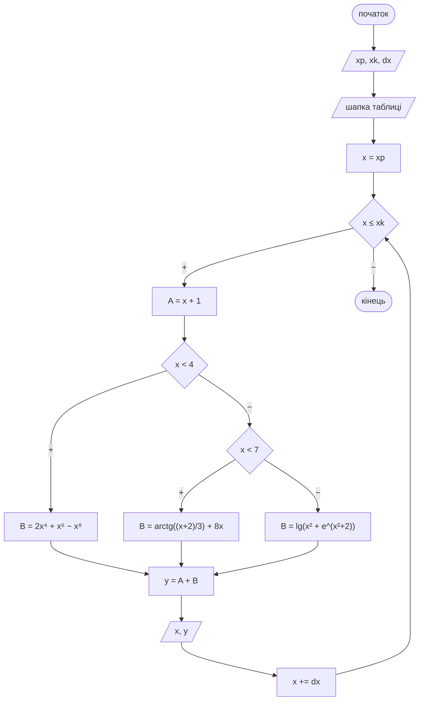
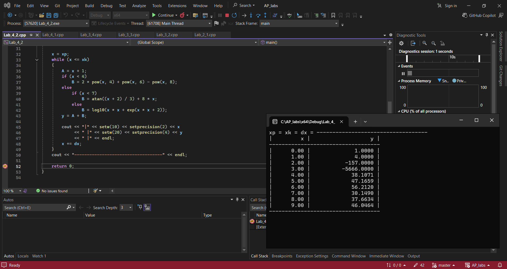

# ЗВІТ

про виконання лабораторної роботи № 4.2
«Табуляція функції, заданої формулою: функція однієї змінної»
з дисципліни «Алгоритмізація та програмування»
студента групи КН-2630б
**Турків Остап Миколайович**

---

## Умова завдання

Обчислити і вивести на екран у вигляді таблиці значення y як функції від аргументу x на інтервалі від X_поч до X_кін з кроком dX. Значення X_поч, X_кін, dX ввести з клавіатури.

**Варіант 33.**

```
              | 2x⁴ + x⁶ − x⁸,           x < 4
y = x + 1 +   | arctg((x+2)/3) + 8x,     4 ≤ x < 7
              | lg(x² + e^(x²+2)),       x ≥ 7
```

## Блок-схема алгоритму



## UML-діаграма дії

```mermaid
flowchart TD
    S((" ")) --> IN("ввід xp, xk, dx")
    IN --> X0("x = xp")
    X0 --> M{" "}
    M --> W{" "}
    W -->|"[x ≤ xk]"| A("A = x + 1")
    A --> D1{" "}
    D1 -->|"[x < 4]"| B1("B = 2x⁴ + x⁶ − x⁸")
    D1 -->|"[else]"| D2{" "}
    D2 -->|"[x < 7]"| B2("B = arctg((x+2)/3) + 8x")
    D2 -->|"[else]"| B3("B = lg(x² + e^(x²+2))")
    B1 --> J{" "}
    B2 --> J
    B3 --> J
    J --> Y("y = A + B")
    Y --> O("вивід x, y")
    O --> I("x += dx")
    I --> M
    W -->|"[else]"| E(((" ")))
    style S fill:#000
    style E fill:#000
```



## Текст програми

Файл [Lab_4_2.cpp](Lab_4_2.cpp):

```cpp
// Lab_4_2.cpp
// Турків Остап Миколайович, група КН-2630б
// Лабораторна робота № 4.2
// Табуляція функції, заданої формулою: функція однієї змінної.
// Варіант 33
//
//                  | 2x^4 + x^6 - x^8,              x < 4
// y = x + 1 +      | arctg((x+2)/3) + 8x,           4 <= x < 7
//                  | lg(x^2 + e^(x^2+2)),           x >= 7

#include <iostream>
#include <iomanip>
#include <cmath>

using namespace std;

int main()
{
    double x, xp, xk, dx; // аргумент, початок, кінець, крок
    double A, B, y;       // стала частина, змінна частина, результат

    cout << "xp = "; cin >> xp;
    cout << "xk = "; cin >> xk;
    cout << "dx = "; cin >> dx;

    cout << fixed;
    cout << "-----------------------------------" << endl;
    cout << "|" << setw(10) << "x" << " |"
         << setw(20) << "y" << " |" << endl;
    cout << "-----------------------------------" << endl;

    x = xp;
    while (x <= xk)
    {
        A = x + 1;
        if (x < 4)
            B = 2 * pow(x, 4) + pow(x, 6) - pow(x, 8);
        else
            if (x < 7)
                B = atan((x + 2) / 3) + 8 * x;
            else
                B = log10(x * x + exp(x * x + 2));
        y = A + B;

        cout << "|" << setw(10) << setprecision(2) << x
             << " |" << setw(20) << setprecision(4) << y
             << " |" << endl;
        x += dx;
    }
    cout << "-----------------------------------" << endl;

    return 0;
}
```

## Результати виконання програми

Програму скомпільовано та запущено у Visual Studio Community 2022 (конфігурація Debug | x64) командою **Debug → Start Debugging**. На рядку `return 0;` поставлено точку переривання, щоб вікно консолі з результатами залишалось відкритим. Вхідні дані: xп = 0, xк = 9, dx = 1. Вони подаються з файлу [input.txt](input.txt) (у властивостях проекту: Debugging → Command Arguments: `< input.txt`), тому у вікні консолі видно лише підказки введення, без самих значень.



**Рис. Виконання програми у Visual Studio 2022**

## Посилання на git-репозиторій з проектом

[https://github.com/ostapturkiv317-creator/AP_labs/tree/master/Lab_4_2](https://github.com/ostapturkiv317-creator/AP_labs/tree/master/Lab_4_2)

## Висновки

Я навчився табулювати функцію, тобто обчислювати її значення в циклі на заданому інтервалі з певним кроком, і виводити результати у вигляді таблиці. Для форматованого виводу використано маніпулятори з `<iomanip>`: `fixed` (фіксована крапка), `setw(n)` (ширина поля) та `setprecision(n)` (кількість цифр після крапки).
