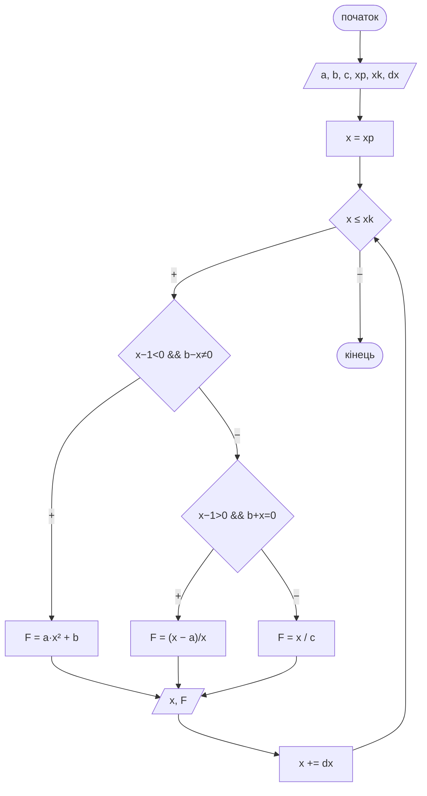

# ЗВІТ

про виконання лабораторної роботи № 4.3
«Табуляція функції, заданої формулою: функція з параметрами»
з дисципліни «Алгоритмізація та програмування»
студента групи КН-2630б
**Турків Остап Миколайович**

---

## Умова завдання

Обчислити і вивести на екран у вигляді таблиці значення функції F на інтервалі від X_поч до X_кін з кроком dX (a, b, c — дійсні числа). Значення a, b, c, X_поч, X_кін, dX ввести з клавіатури.

**Варіант 33.**

```
     | a·x² + b,      при x − 1 < 0 і b − x ≠ 0
F =  | (x − a) / x,   при x − 1 > 0 і b + x = 0
     | x / c,         в інших випадках
```

## Блок-схема алгоритму



## UML-діаграма дії

```mermaid
flowchart TD
    S((" ")) --> IN("ввід a, b, c, xp, xk, dx")
    IN --> X0("x = xp")
    X0 --> M{" "}
    M --> W{" "}
    W -->|"[x ≤ xk]"| D1{" "}
    D1 -->|"[x−1<0 && b−x≠0]"| F1("F = a·x² + b")
    D1 -->|"[else]"| D2{" "}
    D2 -->|"[x−1>0 && b+x=0]"| F2("F = (x − a)/x")
    D2 -->|"[else]"| F3("F = x / c")
    F1 --> J{" "}
    F2 --> J
    F3 --> J
    J --> O("вивід x, F")
    O --> I("x += dx")
    I --> M
    W -->|"[else]"| E(((" ")))
    style S fill:#000
    style E fill:#000
```



## Текст програми

Файл [Lab_4_3.cpp](Lab_4_3.cpp):

```cpp
// Lab_4_3.cpp
// Турків Остап Миколайович, група КН-2630б
// Лабораторна робота № 4.3
// Табуляція функції, заданої формулою: функція з параметрами.
// Варіант 33
//
//      | a*x^2 + b,    при x - 1 < 0 і b - x != 0
// F =  | (x - a) / x,  при x - 1 > 0 і b + x == 0
//      | x / c,        в інших випадках

#include <iostream>
#include <iomanip>

using namespace std;

int main()
{
    double a, b, c;       // параметри
    double x, xp, xk, dx; // аргумент, початок, кінець, крок
    double F;             // результат

    cout << "a = "; cin >> a;
    cout << "b = "; cin >> b;
    cout << "c = "; cin >> c;
    cout << "xp = "; cin >> xp;
    cout << "xk = "; cin >> xk;
    cout << "dx = "; cin >> dx;

    cout << fixed;
    cout << "-----------------------------" << endl;
    cout << "|" << setw(10) << "x" << " |"
         << setw(14) << "F" << " |" << endl;
    cout << "-----------------------------" << endl;

    x = xp;
    while (x <= xk)
    {
        if (x - 1 < 0 && b - x != 0)
            F = a * x * x + b;
        else
            if (x - 1 > 0 && b + x == 0)
                F = (x - a) / x;
            else
                F = x / c;

        cout << "|" << setw(10) << setprecision(2) << x
             << " |" << setw(14) << setprecision(4) << F
             << " |" << endl;
        x += dx;
    }
    cout << "-----------------------------" << endl;

    return 0;
}
```

## Посилання на git-репозиторій з проектом

<!--REPO:Lab_4_3-->

## Висновки

Я поєднав у програмі цикл (табуляцію на інтервалі) та розгалуження з умовами, що залежать від параметрів. Навчився форматувати таблицю результатів за допомогою `setw` і `setprecision`. Помітив, що через неточне представлення дійсних чисел умова `b + x == 0` спрацює лише тоді, коли x точно дорівнює −b, тому параметри та крок табуляції варто обирати так, щоб x міг набути цього значення.
