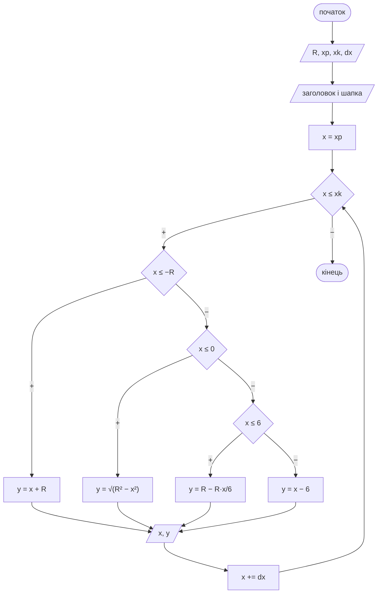

# ЗВІТ

про виконання лабораторної роботи № 4.4
«Табуляція функції, заданої графіком»
з дисципліни «Алгоритмізація та програмування»
студента групи КН-2630б
**Турків Остап Миколайович**

---

## Умова завдання

Обчислити і вивести на екран у вигляді таблиці значення функції, заданої графічно, на проміжку від x_поч до x_кін з кроком dx. Інтервал і крок задати так, щоб перевірити всі гілки розгалуження. Таблиця має містити заголовок і шапку. Параметри R, x_поч, x_кін, dx вводяться з клавіатури.

**Варіант 33.** Графік такий самий, як у лабораторній роботі № 3.3 (варіант 33).

## Математична модель

(Виведення див. у звіті до [Лабораторної роботи № 3.3](../Lab_3_3/README.md).)

```
     | x + R,              x ≤ −R
y =  | √(R² − x²),         −R < x ≤ 0
     | R − R·x/6,          0 < x ≤ 6
     | x − 6,              x > 6
```

Щоб перевірити всі 4 гілки, достатньо, наприклад, R = 3, x_поч = −6, x_кін = 9, dx = 0.5.

## Блок-схема алгоритму



## UML-діаграма дії

```mermaid
flowchart TD
    S((" ")) --> IN("ввід R, xp, xk, dx")
    IN --> X0("x = xp")
    X0 --> M{" "}
    M --> W{" "}
    W -->|"[x ≤ xk]"| D1{" "}
    D1 -->|"[x ≤ −R]"| Y1("y = x + R")
    D1 -->|"[else]"| D2{" "}
    D2 -->|"[x ≤ 0]"| Y2("y = √(R² − x²)")
    D2 -->|"[else]"| D3{" "}
    D3 -->|"[x ≤ 6]"| Y3("y = R − R·x/6")
    D3 -->|"[else]"| Y4("y = x − 6")
    Y1 --> J{" "}
    Y2 --> J
    Y3 --> J
    Y4 --> J
    J --> O("вивід x, y")
    O --> I("x += dx")
    I --> M
    W -->|"[else]"| E(((" ")))
    style S fill:#000
    style E fill:#000
```



## Текст програми

Файл [Lab_4_4.cpp](Lab_4_4.cpp):

```cpp
// Lab_4_4.cpp
// Турків Остап Миколайович, група КН-2630б
// Лабораторна робота № 4.4
// Табуляція функції, заданої графіком.
// Варіант 33
//
//      | x + R,             x <= -R
//  y = | sqrt(R^2 - x^2),   -R < x <= 0
//      | R - R*x/6,         0 < x <= 6
//      | x - 6,             x > 6

#include <iostream>
#include <iomanip>
#include <cmath>

using namespace std;

int main()
{
    double R;             // радіус
    double x, xp, xk, dx; // аргумент, початок, кінець, крок
    double y;             // результат

    cout << "R = "; cin >> R;
    cout << "xp = "; cin >> xp;
    cout << "xk = "; cin >> xk;
    cout << "dx = "; cin >> dx;

    cout << endl << "Tabulation of the function given by the graph (variant 33)" << endl;
    cout << fixed;
    cout << "-----------------------------" << endl;
    cout << "|" << setw(10) << "x" << " |"
         << setw(14) << "y" << " |" << endl;
    cout << "-----------------------------" << endl;

    x = xp;
    while (x <= xk)
    {
        if (x <= -R)
            y = x + R;
        else
            if (x <= 0)
                y = sqrt(R * R - x * x);
            else
                if (x <= 6)
                    y = R - R * x / 6;
                else
                    y = x - 6;

        cout << "|" << setw(10) << setprecision(2) << x
             << " |" << setw(14) << setprecision(4) << y
             << " |" << endl;
        x += dx;
    }
    cout << "-----------------------------" << endl;

    return 0;
}
```

## Посилання на git-репозиторій з проектом

[https://github.com/ostapturkiv317-creator/AP_labs/tree/master/Lab_4_4](https://github.com/ostapturkiv317-creator/AP_labs/tree/master/Lab_4_4)

## Висновки

Я застосував математичну модель функції, заданої графіком, для її табуляції в циклі `while`. Підібрав інтервал і крок так, щоб значення x потрапили на всі чотири ділянки графіка. Це дозволяє перевірити правильність кожної гілки розгалуження, а також неперервність функції в точках стику ділянок (x = −R, x = 0, x = 6).
