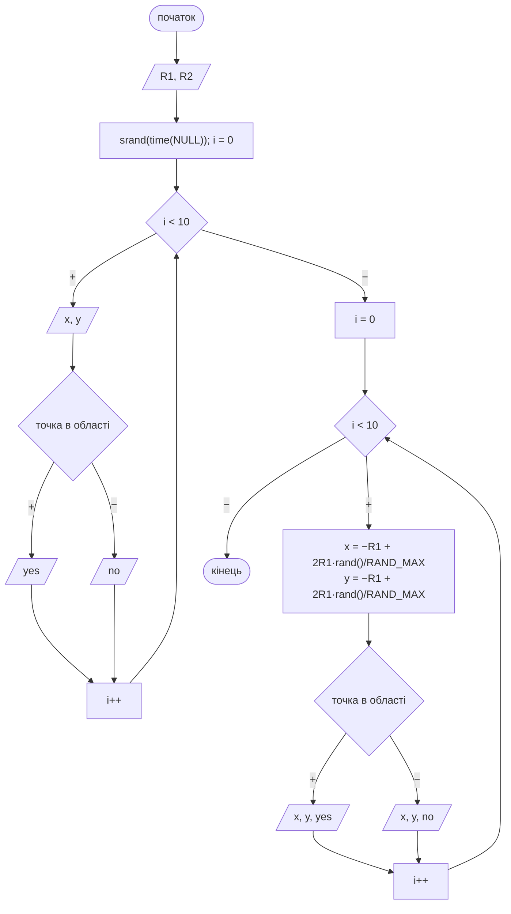

# ЗВІТ

про виконання лабораторної роботи № 4.5
«"Попадання" у плоску фігуру»
з дисципліни «Алгоритмізація та програмування»
студента групи КН-2630б
**Турків Остап Миколайович**

---

## Умова завдання

Написати програму, яка визначає, чи попадають точки, задані двома способами, в область, замальовану на рисунку сірим кольором. Параметри R₁, R₂ вводяться з клавіатури.

1. Для перших десяти пострілів координати (x, y) вводяться з клавіатури; вивести повідомлення про попадання в мішень.
2. Для наступних десяти пострілів координати (x, y) визначаються випадково з інтервалу x, y ∈ [A; B]; вивести координати та повідомлення про попадання.

**Варіант 33.** Фігура така сама, як у лабораторній роботі № 3.4 (варіант 33). 2-й спосіб: інтервал x, y ∈ [−R₁; R₁].

## Математична модель

(Виведення див. у звіті до [Лабораторної роботи № 3.4](../Lab_3_4/README.md).)

```
(x ≤ 0 && y ≥ 0 && x²+y² ≤ R2²) || (x ≥ 0 && y ≤ 0 && x²+y² ≥ R2² && x²+y² ≤ R1²)
```

Випадкове дійсне число з інтервалу [A; B]: `A + (B − A) · rand() / RAND_MAX`, тут A = −R₁, B = R₁.

## Блок-схема алгоритму



## UML-діаграма дії

```mermaid
flowchart TD
    S((" ")) --> IN("ввід R1, R2")
    IN --> SR("srand(time(NULL)); i = 0")
    SR --> M1{" "}
    M1 --> W1{" "}
    W1 -->|"[i < 10]"| XY("ввід x, y")
    XY --> D1{" "}
    D1 -->|"[в області]"| Y1("вивід yes")
    D1 -->|"[else]"| N1("вивід no")
    Y1 --> J1{" "}
    N1 --> J1
    J1 --> I1("i++")
    I1 --> M1
    W1 -->|"[else]"| J0("i = 0")
    J0 --> M2{" "}
    M2 --> W2{" "}
    W2 -->|"[i < 10]"| R("x, y = випадкові з [−R1; R1]")
    R --> D2{" "}
    D2 -->|"[в області]"| Y2("вивід x, y, yes")
    D2 -->|"[else]"| N2("вивід x, y, no")
    Y2 --> J2{" "}
    N2 --> J2
    J2 --> I2("i++")
    I2 --> M2
    W2 -->|"[else]"| E(((" ")))
    style S fill:#000
    style E fill:#000
```



## Текст програми

Файл [Lab_4_5.cpp](Lab_4_5.cpp):

```cpp
// Lab_4_5.cpp
// Турків Остап Миколайович, група КН-2630б
// Лабораторна робота № 4.5
// «Попадання» у плоску фігуру.
// Варіант 33
//
// Область:
//  A: x <= 0, y >= 0, x^2 + y^2 <= R2^2
//  B: x >= 0, y <= 0, R2^2 <= x^2 + y^2 <= R1^2
// 2 спосіб: інтервал x, y належать [-R1; R1]

#include <iostream>
#include <iomanip>
#include <cstdlib>
#include <ctime>

using namespace std;

int main()
{
    double x, y;   // координати пострілу
    double R1, R2; // радіуси кіл

    cout << "R1 = "; cin >> R1;
    cout << "R2 = "; cin >> R2;

    srand((unsigned)time(NULL));

    // 1 спосіб: 10 пострілів, координати вводяться з клавіатури
    for (int i = 0; i < 10; i++)
    {
        cout << "x = "; cin >> x;
        cout << "y = "; cin >> y;

        double d = x * x + y * y;
        if ((x <= 0 && y >= 0 && d <= R2 * R2) ||
            (x >= 0 && y <= 0 && d >= R2 * R2 && d <= R1 * R1))
            cout << "yes" << endl;
        else
            cout << "no" << endl;
    }

    cout << endl << fixed;

    // 2 спосіб: 10 випадкових пострілів з інтервалу [-R1; R1]
    for (int i = 0; i < 10; i++)
    {
        x = -R1 + 2.0 * R1 * rand() / RAND_MAX;
        y = -R1 + 2.0 * R1 * rand() / RAND_MAX;

        double d = x * x + y * y;
        cout << setw(8) << setprecision(4) << x << "  "
             << setw(8) << setprecision(4) << y << "  ";
        if ((x <= 0 && y >= 0 && d <= R2 * R2) ||
            (x >= 0 && y <= 0 && d >= R2 * R2 && d <= R1 * R1))
            cout << "yes" << endl;
        else
            cout << "no" << endl;
    }

    return 0;
}
```

## Посилання на git-репозиторій з проектом

[https://github.com/ostapturkiv317-creator/AP_labs/tree/master/Lab_4_5](https://github.com/ostapturkiv317-creator/AP_labs/tree/master/Lab_4_5)

## Висновки

Я навчився генерувати псевдовипадкові дійсні числа з заданого інтервалу за допомогою `rand()` та ініціалізувати генератор від системного таймера (`srand(time(NULL))`), щоб при кожному запуску отримувати нову послідовність. Перевірку попадання точки в область виконано тим самим складеним логічним виразом, що й у лабораторній роботі 3.4, але тепер у циклі `for` для серії пострілів.
