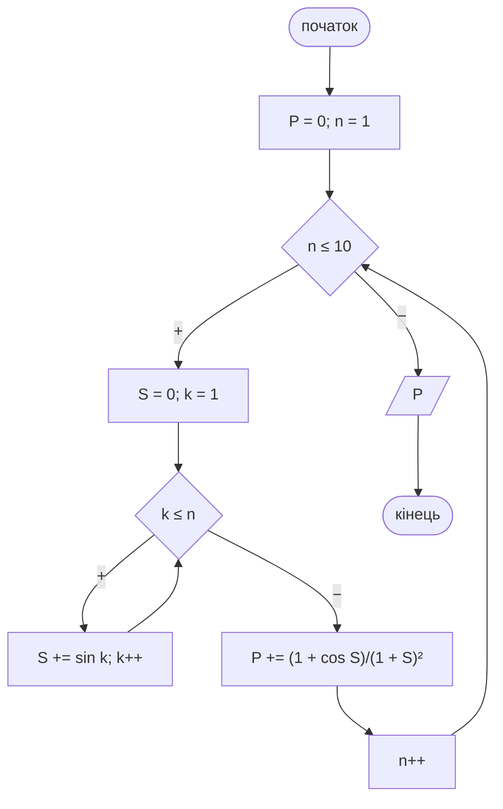
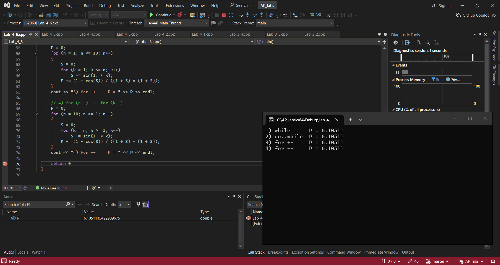

# ЗВІТ

про виконання лабораторної роботи № 4.6
«Вкладені цикли»
з дисципліни «Алгоритмізація та програмування»
студента групи КН-2630б
**Турків Остап Миколайович**

---

## Умова завдання

Написати програму, яка обчислює значення вказаного виразу за допомогою вкладених циклів. В одній програмі вивести результати обчислень чотирма способами: 1) `while(…) {… while(…) {…} …}`; 2) `do{… do{…} while(…) …} while(…)`; 3) `for(…; …; n++) {… for(…; …; k++) {…} …}`; 4) `for(…; …; n--) {… for(…; …; k--) {…} …}`. Усі 4 результати мають збігатися.

**Варіант 33.**

```
       10   1 + cos( Σ_{k=1}^{n} sin k )
P =   Σ    --------------------------------
      n=1   ( 1 + Σ_{k=1}^{n} sin k )²
```

## Побудова алгоритму

- **Крок 1.** На зовнішньому рівні це сума: P = Σ_{n=1}^{10} bₙ, схема: `P = 0`, у циклі `P += bₙ`.
- **Крок 2.** Кожен доданок має вигляд bₙ = (1 + cos Sₙ)/(1 + Sₙ)², де Sₙ = Σ_{k=1}^{n} sin k.
- **Крок 3.** На внутрішньому рівні це сума Sₙ, схема: `S = 0`, у циклі `S += sin k`.

## Блок-схема алгоритму (спосіб 1: while … while)



Способи 2–4 мають ту саму структуру: у способі 2 умови перевіряються після тіла циклу, у способі 4 параметри змінюються від верхньої межі до нижньої (n = 10..1, k = n..1).

## UML-діаграма дії (спосіб 2: do … while)

```mermaid
flowchart TD
    S0((" ")) --> P0("P = 0; n = 1")
    P0 --> M1{" "}
    M1 --> S1("S = 0; k = 1")
    S1 --> M2{" "}
    M2 --> B("S += sin k")
    B --> K("k++")
    K --> W2{" "}
    W2 -->|"[k ≤ n]"| M2
    W2 -->|"[else]"| PB("P += (1 + cos S)/(1 + S)²")
    PB --> N("n++")
    N --> W1{" "}
    W1 -->|"[n ≤ 10]"| M1
    W1 -->|"[else]"| O("вивід P")
    O --> E(((" ")))
    style S0 fill:#000
    style E fill:#000
```



## Текст програми

Файл [Lab_4_6.cpp](Lab_4_6.cpp):

```cpp
// Lab_4_6.cpp
// Турків Остап Миколайович, група КН-2630б
// Лабораторна робота № 4.6
// Вкладені цикли.
// Варіант 33
//
//        10   1 + cos( sum_{k=1}^{n} sin k )
// P =   SUM   ------------------------------
//       n=1    ( 1 + sum_{k=1}^{n} sin k )^2

#include <iostream>
#include <cmath>

using namespace std;

int main()
{
    double P; // зовнішня сума
    double S; // внутрішня сума S_n = sum sin k
    int n, k; // параметри циклів

    // 1) while ... while
    P = 0;
    n = 1;
    while (n <= 10)
    {
        S = 0;
        k = 1;
        while (k <= n)
        {
            S += sin(1. * k);
            k++;
        }
        P += (1 + cos(S)) / ((1 + S) * (1 + S));
        n++;
    }
    cout << "1) while      P = " << P << endl;

    // 2) do ... while
    P = 0;
    n = 1;
    do {
        S = 0;
        k = 1;
        do {
            S += sin(1. * k);
            k++;
        } while (k <= n);
        P += (1 + cos(S)) / ((1 + S) * (1 + S));
        n++;
    } while (n <= 10);
    cout << "2) do..while  P = " << P << endl;

    // 3) for (n++) ... for (k++)
    P = 0;
    for (n = 1; n <= 10; n++)
    {
        S = 0;
        for (k = 1; k <= n; k++)
            S += sin(1. * k);
        P += (1 + cos(S)) / ((1 + S) * (1 + S));
    }
    cout << "3) for ++     P = " << P << endl;

    // 4) for (n--) ... for (k--)
    P = 0;
    for (n = 10; n >= 1; n--)
    {
        S = 0;
        for (k = n; k >= 1; k--)
            S += sin(1. * k);
        P += (1 + cos(S)) / ((1 + S) * (1 + S));
    }
    cout << "4) for --     P = " << P << endl;

    return 0;
}
```

## Результати виконання програми

Програму скомпільовано та запущено у Visual Studio Community 2022 (конфігурація Debug | x64) командою **Debug → Start Debugging**. На рядку `return 0;` поставлено точку переривання, щоб вікно консолі з результатами залишалось відкритим. Програма не потребує вхідних даних.



**Рис. Виконання програми у Visual Studio 2022**

## Посилання на git-репозиторій з проектом

[https://github.com/ostapturkiv317-creator/AP_labs/tree/master/Lab_4_6](https://github.com/ostapturkiv317-creator/AP_labs/tree/master/Lab_4_6)

## Висновки

Я навчився будувати алгоритми з вкладеними циклами покроково: спочатку описати зовнішній цикл (суму за n), потім виразити його доданок через внутрішню величину Sₙ і, нарешті, описати внутрішній цикл (суму за k). Важливо обнуляти внутрішню суму S на початку кожної ітерації зовнішнього циклу. Чотири реалізації (`while`, `do…while`, `for` з `++` та з `--`) дають однаковий результат.
