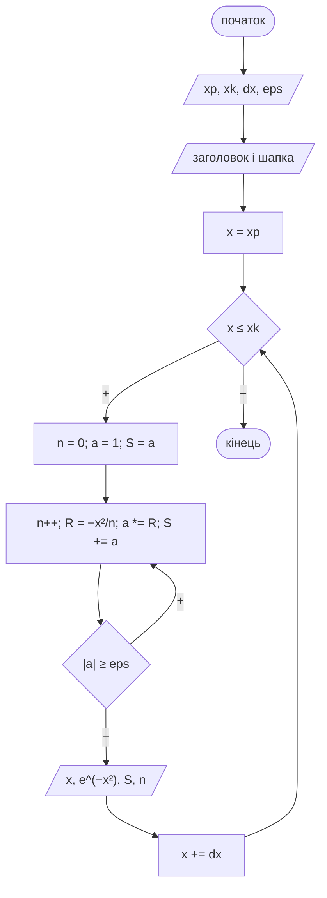

# ЗВІТ

про виконання лабораторної роботи № 4.7
«Обчислення суми ряду Тейлора за допомогою ітераційних циклів та рекурентних співвідношень»
з дисципліни «Алгоритмізація та програмування»
студента групи КН-2630б
**Турків Остап Миколайович**

---

## Умова завдання

Обчислити і вивести на екран у вигляді таблиці значення функції, заданої рядом Тейлора, на інтервалі від x_поч до x_кін з кроком dx та точністю ε. Параметри x_поч, x_кін, dx, eps вводяться з клавіатури. Таблиця має містити заголовок та шапку. Кожен рядок таблиці має містити значення аргументу, значення функції, значення суми ряду та кількість обчислених доданків. Доданки обчислювати за рекурентним співвідношенням.

**Варіант 33.**

```
           ∞   (−1)ⁿ x²ⁿ              x⁴     x⁶     x⁸
e^(−x²) = Σ   ----------- = 1 − x² + ---- − ---- + ---- − …,   |x| < ∞
          n=0      n!                  2!     3!     4!
```

## Рекурентне співвідношення

Перший доданок: a₀ = (−1)⁰ x⁰ / 0! = 1.

Коефіцієнт рекурентності:

```
       aₙ        (−1)ⁿ x²ⁿ / n!                       x²ⁿ      (n−1)!         x²
R = ------- = ---------------------------- = (−1) · -------- · -------- = − ----
     aₙ₋₁     (−1)ⁿ⁻¹ x²⁽ⁿ⁻¹⁾ / (n−1)!               x²ⁿ⁻²       n!           n
```

Отже, aₙ = aₙ₋₁ · R, де **R = −x²/n**.

## Блок-схема алгоритму



## UML-діаграма дії

```mermaid
flowchart TD
    S0((" ")) --> IN("ввід xp, xk, dx, eps")
    IN --> X0("x = xp")
    X0 --> M1{" "}
    M1 --> W{" "}
    W -->|"[x ≤ xk]"| I0("n = 0; a = 1; S = a")
    I0 --> M2{" "}
    M2 --> N("n++")
    N --> R("R = −x²/n")
    R --> A("a *= R")
    A --> SS("S += a")
    SS --> C{" "}
    C -->|"[abs(a) ≥ eps]"| M2
    C -->|"[else]"| O("вивід x, e^(−x²), S, n")
    O --> X("x += dx")
    X --> M1
    W -->|"[else]"| E(((" ")))
    style S0 fill:#000
    style E fill:#000
```



## Текст програми

Файл [Lab_4_7.cpp](Lab_4_7.cpp):

```cpp
// Lab_4_7.cpp
// Турків Остап Миколайович, група КН-2630б
// Лабораторна робота № 4.7
// Обчислення суми ряду Тейлора за допомогою ітераційних циклів
// та рекурентних співвідношень.
// Варіант 33
//
// e^(-x^2) = sum_{n=0}^{inf} (-1)^n x^(2n) / n! = 1 - x^2 + x^4/2! - x^6/3! + ...
//
// Перший доданок:          a0 = 1
// Коефіцієнт рекурентності: R = a_n / a_(n-1) = -x^2 / n

#include <iostream>
#include <iomanip>
#include <cmath>

using namespace std;

int main()
{
    double xp, xk, x, dx, eps; // інтервал, крок, точність
    double a = 0, R = 0, S = 0; // доданок, коефіцієнт, сума
    int n = 0;                 // номер доданку

    cout << "xp = "; cin >> xp;
    cout << "xk = "; cin >> xk;
    cout << "dx = "; cin >> dx;
    cout << "eps = "; cin >> eps;

    cout << endl << "Taylor series for exp(-x^2)" << endl;
    cout << fixed;
    cout << "-------------------------------------------------" << endl;
    cout << "|" << setw(7) << "x" << " |"
         << setw(12) << "exp(-x^2)" << " |"
         << setw(12) << "S" << " |"
         << setw(5) << "n" << " |" << endl;
    cout << "-------------------------------------------------" << endl;

    x = xp;
    while (x <= xk)
    {
        n = 0;
        a = 1;
        S = a;
        do {
            n++;
            R = -x * x / n;
            a *= R;
            S += a;
        } while (abs(a) >= eps);

        cout << "|" << setw(7) << setprecision(2) << x << " |"
             << setw(12) << setprecision(6) << exp(-x * x) << " |"
             << setw(12) << setprecision(6) << S << " |"
             << setw(5) << n << " |" << endl;
        x += dx;
    }
    cout << "-------------------------------------------------" << endl;

    return 0;
}
```

## Посилання на git-репозиторій з проектом

<!--REPO:Lab_4_7-->

## Висновки

Я навчився обчислювати суму нескінченного ряду з заданою точністю за допомогою ітераційного циклу `do…while`, умовою виходу з якого є `|aₙ| < eps`. Рекурентне співвідношення aₙ = aₙ₋₁ · (−x²/n) дозволяє не обчислювати степені та факторіали заново для кожного доданка. Це зменшує кількість операцій і запобігає переповненню при великих n. Порівняння стовпців `exp(-x^2)` та `S` у таблиці підтверджує правильність обчислень.
