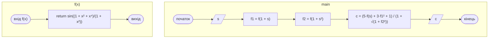
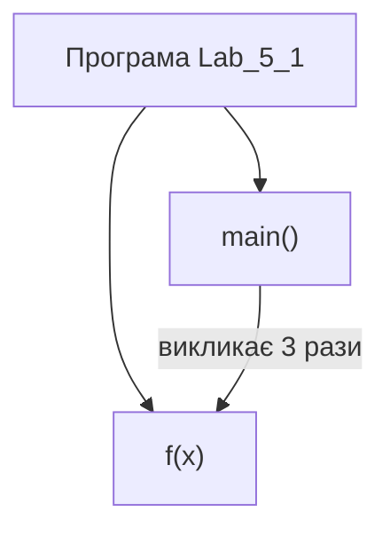

# ЗВІТ

про виконання лабораторної роботи № 5.1
«Функції, що містять арифметичний вираз»
з дисципліни «Алгоритмізація та програмування»
студента групи КН-2630б
**Турків Остап Миколайович**

---

## Умова завдання

Обчислити і вивести на екран значення виразу. Використовувати допоміжний алгоритм, реалізований окремою функцією.

**Варіант 33.** Дано дійсне s. Обчислити

```
   5·f(s) + 3·f²(1 + s) + 1
 ------------------------------ ,
  1 + √( 1 + f²(1 + s²) )

де  f(x) = sin( (1 + x² + x⁴) / (1 + x²) )
```

## Блок-схеми алгоритму програми та функції



## UML-діаграма дії програми та функції

```mermaid
flowchart TD
    subgraph main
    S((" ")) --> IN("ввід s")
    IN --> F1("f1 = f(1 + s)")
    F1 --> F2("f2 = f(1 + s²)")
    F2 --> C("c = (5·f(s) + 3·f1² + 1)/(1 + √(1 + f2²))")
    C --> O("вивід c")
    O --> E(((" ")))
    end
    subgraph sg2 ["f(x)"]
    FS((" ")) --> FR("return sin((1 + x² + x⁴)/(1 + x²))")
    FR --> FE(((" ")))
    end
    style S fill:#000
    style E fill:#000
    style FS fill:#000
    style FE fill:#000
```



## Структурна схема програми



## Текст програми

Файл [Lab_5_1.cpp](Lab_5_1.cpp):

```cpp
// Lab_5_1.cpp
// Турків Остап Миколайович, група КН-2630б
// Лабораторна робота № 5.1
// Функції, що містять арифметичний вираз.
// Варіант 33
//
// Дано дійсне s. Обчислити
//      5 f(s) + 3 f^2(1 + s) + 1
//   -------------------------------- ,
//    1 + sqrt( 1 + f^2(1 + s^2) )
// де
//   f(x) = sin( (1 + x^2 + x^4) / (1 + x^2) )

#include <iostream>
#include <cmath>

using namespace std;

double f(const double x); // прототип

int main()
{
    double s; // вхідне дійсне число

    cout << "s = "; cin >> s;

    double f1 = f(1 + s);
    double f2 = f(1 + s * s);
    double c = (5 * f(s) + 3 * f1 * f1 + 1) / (1 + sqrt(1 + f2 * f2));

    cout << "c = " << c << endl;

    return 0;
}

// визначення допоміжної функції
double f(const double x)
{
    return sin((1 + x * x + x * x * x * x) / (1 + x * x));
}
```

## Посилання на git-репозиторій з проектом

<!--REPO:Lab_5_1-->

## Результати unit-тесту

Unit-тест для функції `f(x)` наведено в [Лабораторній роботі № 5.0](../Lab_5_0/README.md).

## Висновки

Я навчився оголошувати (прототип) та визначати власні функції в C++, передавати їм аргументи через параметри-значення і повертати результат командою `return`. Виділення повторюваного виразу `f(x)` в окрему функцію робить програму коротшою і зрозумілішою. Значення `f(1+s)` та `f(1+s²)` обчислюються один раз і зберігаються в змінних, щоб не викликати функцію повторно при піднесенні до квадрата.
