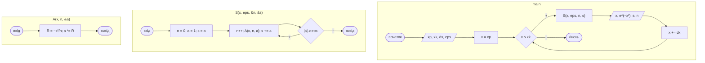
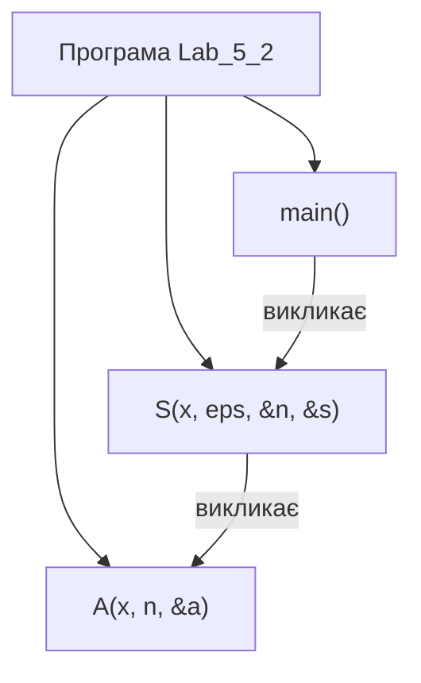

# ЗВІТ

про виконання лабораторної роботи № 5.2
«Обчислення суми ряду Тейлора за допомогою функцій»
з дисципліни «Алгоритмізація та програмування»
студента групи КН-2630б
**Турків Остап Миколайович**

---

## Умова завдання

Обчислити і вивести на екран у вигляді таблиці значення функції, заданої рядом Тейлора, на інтервалі від x_поч до x_кін з кроком dx та точністю ε. Параметри вводяться з клавіатури. Таблиця має містити заголовок, шапку, значення аргументу, функції, суми ряду та кількість доданків. Суму ряду та значення доданку обчислювати окремими функціями. Доданки обчислювати за рекурентним співвідношенням. Усю інформацію передавати функціям лише через параметри.

**Варіант 33.**

```
           ∞   (−1)ⁿ x²ⁿ
e^(−x²) = Σ   -----------,     a₀ = 1,   R = aₙ / aₙ₋₁ = −x²/n
          n=0      n!
```

(Виведення коефіцієнта рекурентності див. у звіті до [Лабораторної роботи № 4.7](../Lab_4_7/README.md).)

## Блок-схеми алгоритму програми та кожної функції



## UML-діаграма дії програми та кожної функції

```mermaid
flowchart TD
    subgraph main
    S0((" ")) --> IN("ввід xp, xk, dx, eps")
    IN --> X0("x = xp")
    X0 --> M{" "}
    M --> W{" "}
    W -->|"[x ≤ xk]"| CS("S(x, eps, n, s)")
    CS --> O("вивід рядка таблиці")
    O --> X("x += dx")
    X --> M
    W -->|"[else]"| E(((" ")))
    end
    subgraph sg3 ["S(...)"]
    SS((" ")) --> I0("n = 0; a = 1; s = a")
    I0 --> M2{" "}
    M2 --> B("n++; A(x, n, a); s += a")
    B --> C{" "}
    C -->|"[abs(a) ≥ eps]"| M2
    C -->|"[else]"| SE(((" ")))
    end
    subgraph sg4 ["A(...)"]
    AS((" ")) --> R("a *= −x²/n")
    R --> AE(((" ")))
    end
    style S0 fill:#000
    style E fill:#000
    style SS fill:#000
    style SE fill:#000
    style AS fill:#000
    style AE fill:#000
```



## Структурна схема програми



## Текст програми

Файл [Lab_5_2.cpp](Lab_5_2.cpp):

```cpp
// Lab_5_2.cpp
// Турків Остап Миколайович, група КН-2630б
// Лабораторна робота № 5.2
// Обчислення суми ряду Тейлора за допомогою функцій.
// Варіант 33
//
// e^(-x^2) = sum_{n=0}^{inf} (-1)^n x^(2n) / n!
// a0 = 1,  R = -x^2 / n

#include <iostream>
#include <iomanip>
#include <cmath>

using namespace std;

void S(const double x, const double eps, int &n, double &s); // сума ряду
void A(const double x, const int n, double &a);              // наступний доданок

int main()
{
    double xp, xk, x, dx, eps, s = 0;
    int n = 0;

    cout << "xp = "; cin >> xp;
    cout << "xk = "; cin >> xk;
    cout << "dx = "; cin >> dx;
    cout << "eps = "; cin >> eps;

    cout << endl << "Taylor series for exp(-x^2)" << endl;
    cout << fixed;
    cout << "-------------------------------------------------" << endl;
    cout << "|" << setw(7) << "x" << " |"
         << setw(12) << "exp(-x^2)" << " |"
         << setw(12) << "S" << " |"
         << setw(5) << "n" << " |" << endl;
    cout << "-------------------------------------------------" << endl;

    x = xp;
    while (x <= xk)
    {
        S(x, eps, n, s);

        cout << "|" << setw(7) << setprecision(2) << x << " |"
             << setw(12) << setprecision(6) << exp(-x * x) << " |"
             << setw(12) << setprecision(6) << s << " |"
             << setw(5) << n << " |" << endl;
        x += dx;
    }
    cout << "-------------------------------------------------" << endl;

    return 0;
}

// обчислює суму ряду s з точністю eps, n - кількість доданків
void S(const double x, const double eps, int &n, double &s)
{
    n = 0;
    double a = 1; // перший доданок
    s = a;
    do {
        n++;
        A(x, n, a);
        s += a;
    } while (abs(a) >= eps);
}

// обчислює n-й доданок через (n-1)-й за рекурентним співвідношенням
void A(const double x, const int n, double &a)
{
    double R = -x * x / n;
    a *= R;
}
```

## Посилання на git-репозиторій з проектом

<!--REPO:Lab_5_2-->

## Результати unit-тесту

Unit-тест виконано для функції лабораторної роботи № 5.1 (див. [Лабораторну роботу № 5.0](../Lab_5_0/README.md)).

## Висновки

Я навчився розбивати програму на функції та передавати інформацію через параметри-значення (`const double x`) і параметри-посилання (`int &n`, `double &s`, `double &a`). Параметри-посилання дозволяють функції повернути кілька результатів одночасно (суму ряду і кількість доданків). Функція `A` обчислює наступний доданок за рекурентним співвідношенням, а функція `S` підсумовує ряд до досягнення заданої точності.
