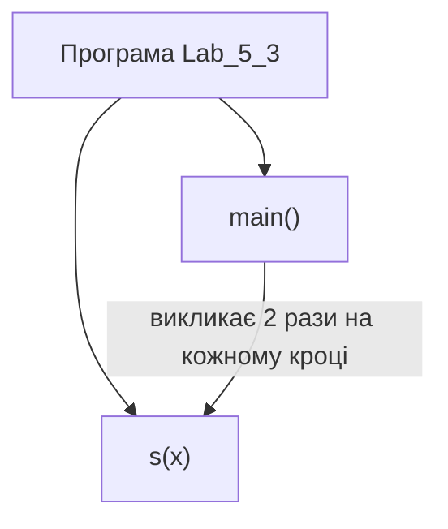

# ЗВІТ

про виконання лабораторної роботи № 5.3
«Функції, що містять розгалуження та цикли з рекурентними співвідношеннями»
з дисципліни «Алгоритмізація та програмування»
студента групи КН-2630б
**Турків Остап Миколайович**

---

## Умова завдання

Обчислити і вивести на екран у вигляді таблиці значення виразу від дійсного r на інтервалі від r_поч до r_кін з n відрізками розбиття. Параметри r_поч, r_кін, n вводяться з клавіатури. Таблиця має містити заголовок та шапку, значення r та значення виразу. Використовувати допоміжний алгоритм, реалізований окремою функцією. Доданки в сумі обчислювати за рекурентними співвідношеннями.

**Варіант 33.**

```
s(√r + 1) − s²(√r − 1) + 1,   де

        | (1 + x² + √|sin x|) / (sin²(2x²) + 1),           |x| ≥ 1
s(x) =  |
        | Σ_{i=0}^{5} xⁱ/i!  +  Σ_{k=1}^{6} xᵏ/k!,         |x| < 1
```

## Рекурентні співвідношення

- Перша сума: a₀ = x⁰/0! = 1, R = aᵢ/aᵢ₋₁ = (xⁱ/i!) / (xⁱ⁻¹/(i−1)!) = **x / i**.
- Друга сума: a₁ = x¹/1! = x, R = **x / k**.

Оскільки вираз містить √r, він визначений лише для r ≥ 0. Для r < 0 програма виводить `undefined`.

## Блок-схеми алгоритму програми та функції

```mermaid
flowchart TD
    subgraph main
    S0(["початок"]) --> IN[/"rp, rk, n"/]
    IN --> D["dr = (rk − rp)/n; r = rp"]
    D --> W{"r ≤ rk"}
    W -- "+" --> C0{"r < 0"}
    C0 -- "+" --> U[/"r, undefined"/]
    C0 -- "−" --> Z["t = s(√r − 1)<br/>z = s(√r + 1) − t² + 1"]
    Z --> O[/"r, z"/]
    U --> I["r += dr"]
    O --> I
    I --> W
    W -- "−" --> E(["кінець"])
    end
    subgraph sg1 ["s(x)"]
    FS(["вхід"]) --> C1{"|x| ≥ 1"}
    C1 -- "+" --> R1["return (1 + x² + √|sin x|)/(sin²(2x²) + 1)"]
    C1 -- "−" --> A1["S1 = 1; a = 1; i = 0"]
    A1 --> L1["i++; a *= x/i; S1 += a"]
    L1 --> C2{"i < 5"}
    C2 -- "+" --> L1
    C2 -- "−" --> A2["S2 = x; a = x; k = 1"]
    A2 --> L2["k++; a *= x/k; S2 += a"]
    L2 --> C3{"k < 6"}
    C3 -- "+" --> L2
    C3 -- "−" --> R2["return S1 + S2"]
    R1 --> FE(["вихід"])
    R2 --> FE
    end
```



## UML-діаграма дії функції s(x)

```mermaid
flowchart TD
    FS((" ")) --> D1{" "}
    D1 -->|"[abs(x) ≥ 1]"| R1("return (1 + x² + √|sin x|)/(sin²(2x²) + 1)")
    D1 -->|"[else]"| A1("S1 = 1; a = 1; i = 0")
    A1 --> M1{" "}
    M1 --> L1("i++; a *= x/i; S1 += a")
    L1 --> C2{" "}
    C2 -->|"[i < 5]"| M1
    C2 -->|"[else]"| A2("S2 = x; a = x; k = 1")
    A2 --> M2{" "}
    M2 --> L2("k++; a *= x/k; S2 += a")
    L2 --> C3{" "}
    C3 -->|"[k < 6]"| M2
    C3 -->|"[else]"| R2("return S1 + S2")
    R1 --> J{" "}
    R2 --> J
    J --> FE(((" ")))
    style FS fill:#000
    style FE fill:#000
```



UML-діаграма дії `main()` повторює блок-схему: цикл по r з розгалуженням `[r < 0]` / `[else]`.

## Структурна схема програми



## Текст програми

Файл [Lab_5_3.cpp](Lab_5_3.cpp):

```cpp
// Lab_5_3.cpp
// Турків Остап Миколайович, група КН-2630б
// Лабораторна робота № 5.3
// Функції, що містять розгалуження та цикли з рекурентними співвідношеннями.
// Варіант 33
//
// Обчислити  s(sqrt(r) + 1) - s^2(sqrt(r) - 1) + 1,  де
//
//         | (1 + x^2 + sqrt|sin x|) / (sin^2(2x^2) + 1),      |x| >= 1
// s(x) =  |
//         | sum_{i=0}^{5} x^i / i!  +  sum_{k=1}^{6} x^k / k!, |x| < 1
//
// Рекурентні співвідношення:
//   1-а сума: a0 = 1, R = x / i
//   2-а сума: a1 = x, R = x / k

#include <iostream>
#include <iomanip>
#include <cmath>

using namespace std;

double s(const double x);

int main()
{
    double rp, rk, z; // початок, кінець інтервалу, значення виразу
    int n;            // кількість відрізків розбиття

    cout << "rp = "; cin >> rp;
    cout << "rk = "; cin >> rk;
    cout << "n = "; cin >> n;

    double dr = (rk - rp) / n;

    cout << endl << "Table of the expression (variant 33)" << endl;
    cout << fixed;
    cout << "-----------------------------" << endl;
    cout << "|" << setw(10) << "r" << " |" << setw(14) << "z" << " |" << endl;
    cout << "-----------------------------" << endl;

    double r = rp;
    while (r <= rk + dr / 2) // + dr/2 - щоб не втратити останню точку через похибку
    {
        if (r < 0)
        {
            cout << "|" << setw(10) << setprecision(3) << r
                 << " |" << setw(14) << "undefined" << " |" << endl;
        }
        else
        {
            double t = s(sqrt(r) - 1);
            z = s(sqrt(r) + 1) - t * t + 1;
            cout << "|" << setw(10) << setprecision(3) << r
                 << " |" << setw(14) << setprecision(5) << z << " |" << endl;
        }
        r += dr;
    }
    cout << "-----------------------------" << endl;

    return 0;
}

double s(const double x)
{
    if (abs(x) >= 1)
        return (1 + x * x + sqrt(abs(sin(x)))) / (sin(2 * x * x) * sin(2 * x * x) + 1);
    else
    {
        // сума x^i / i!, i = 0..5
        double S1 = 0;
        double a = 1;  // a0
        S1 = a;
        int i = 0;
        do {
            i++;
            a *= x / i; // R = x / i
            S1 += a;
        } while (i < 5);

        // сума x^k / k!, k = 1..6
        double S2 = 0;
        int k = 1;
        a = x;         // a1
        S2 = a;
        do {
            k++;
            a *= x / k; // R = x / k
            S2 += a;
        } while (k < 6);

        return S1 + S2;
    }
}
```

## Посилання на git-репозиторій з проектом

[https://github.com/ostapturkiv317-creator/AP_labs/tree/master/Lab_5_3](https://github.com/ostapturkiv317-creator/AP_labs/tree/master/Lab_5_3)

## Результати unit-тесту

Unit-тест виконано для функції лабораторної роботи № 5.1 (див. [Лабораторну роботу № 5.0](../Lab_5_0/README.md)).

## Висновки

Я реалізував функцію, яка містить і розгалуження (за значенням |x|), і цикли з рекурентними співвідношеннями для обчислення скінченних сум. Рекурентні співвідношення aᵢ = aᵢ₋₁·x/i дозволяють обчислювати xⁱ/i! без окремого обчислення степеня та факторіала. Також врахував область визначення виразу (√r існує лише для r ≥ 0) і додав відповідну перевірку.
