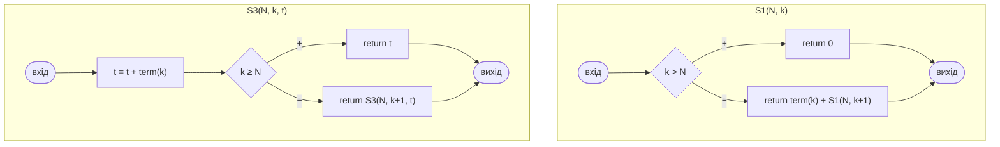
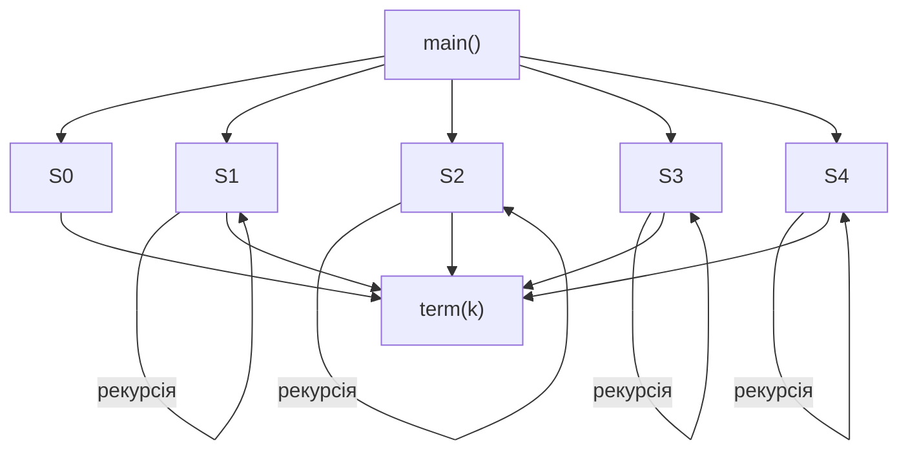
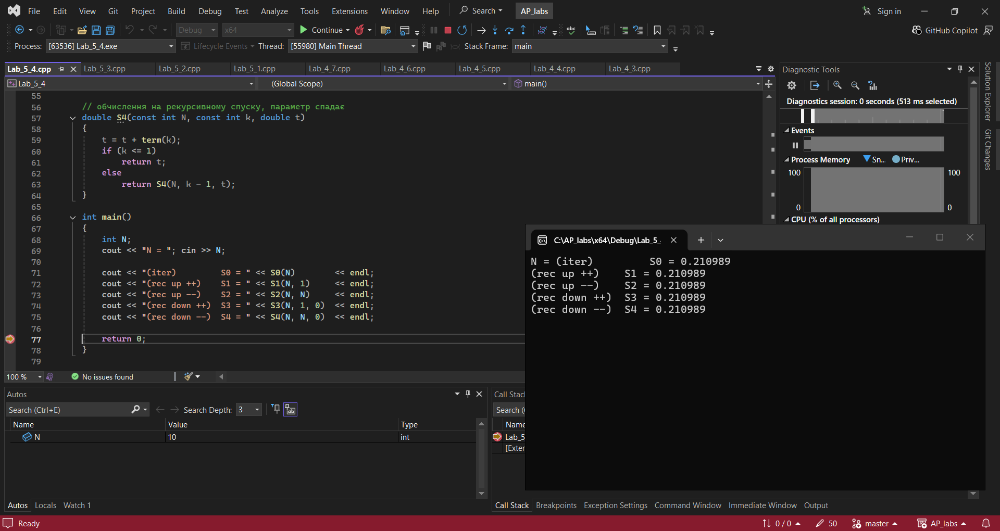

# ЗВІТ

про виконання лабораторної роботи № 5.4
«Обчислення сум та добутків за допомогою рекурсії»
з дисципліни «Алгоритмізація та програмування»
студента групи КН-2630б
**Турків Остап Миколайович**

---

## Умова завдання

За допомогою рекурсивних функцій обчислити значення суми. В одній програмі вивести результати п'яти функцій, які реалізують способи:

1. обчислення на рекурсивному спуску, параметр у рекурсивних викликах спадає;
2. обчислення на рекурсивному спуску, параметр зростає;
3. обчислення на рекурсивному підйомі, параметр спадає;
4. обчислення на рекурсивному підйомі, параметр зростає;
5. ітераційний спосіб (для контролю).

Усі п'ять результатів мають збігатися. Усю інформацію передавати функціям лише через параметри.

**Варіант 33.**

```
       N        1
S =   Σ    ----------
      k=1   (2k + 1)²
```

## Рекурсивні визначення

| Функція | Де обчислюється | Параметр | Базова задача | Рекурсивний виклик |
|---|---|---|---|---|
| `S1(N, k)` | на підйомі (після повернення) | зростає: `k+1` | `k > N` → `0` | `term(k) + S1(N, k+1)` |
| `S2(N, k)` | на підйомі | спадає: `k−1` | `k < 1` → `0` | `term(k) + S2(N, k−1)` |
| `S3(N, k, t)` | на спуску (до виклику) | зростає: `k+1` | `k ≥ N` → `t` | `S3(N, k+1, t + term(k))` |
| `S4(N, k, t)` | на спуску | спадає: `k−1` | `k ≤ 1` → `t` | `S4(N, k−1, t + term(k))` |
| `S0(N)` | ітераційно | — | — | цикл `for` |

`term(k) = 1 / (2k + 1)²`.

## Блок-схеми функцій



Функції `S2` та `S4` мають таку саму структуру, але з умовами `k < 1` / `k ≤ 1` та викликами з `k − 1`.

## UML-діаграма дії програми

```mermaid
flowchart TD
    S((" ")) --> IN("ввід N")
    IN --> O0("вивід S0(N)")
    O0 --> O1("вивід S1(N, 1)")
    O1 --> O2("вивід S2(N, N)")
    O2 --> O3("вивід S3(N, 1, 0)")
    O3 --> O4("вивід S4(N, N, 0)")
    O4 --> E(((" ")))
    style S fill:#000
    style E fill:#000
```



## Структурна схема програми



## Текст програми

Файл [Lab_5_4.cpp](Lab_5_4.cpp):

```cpp
// Lab_5_4.cpp
// Турків Остап Миколайович, група КН-2630б
// Лабораторна робота № 5.4
// Обчислення сум та добутків за допомогою рекурсії.
// Варіант 33
//
// S = sum_{k=1}^{N} 1 / (2k + 1)^2

#include <iostream>

using namespace std;

// доданок суми
double term(const int k)
{
    return 1.0 / ((2 * k + 1) * (2 * k + 1));
}

// 5) ітераційний спосіб (контроль)
double S0(const int N)
{
    double s = 0;
    for (int k = 1; k <= N; k++)
        s += term(k);
    return s;
}

// обчислення на рекурсивному підйомі, параметр зростає
double S1(const int N, const int k)
{
    if (k > N)
        return 0;
    else
        return term(k) + S1(N, k + 1);
}

// обчислення на рекурсивному підйомі, параметр спадає
double S2(const int N, const int k)
{
    if (k < 1)
        return 0;
    else
        return term(k) + S2(N, k - 1);
}

// обчислення на рекурсивному спуску, параметр зростає
double S3(const int N, const int k, double t)
{
    t = t + term(k);
    if (k >= N)
        return t;
    else
        return S3(N, k + 1, t);
}

// обчислення на рекурсивному спуску, параметр спадає
double S4(const int N, const int k, double t)
{
    t = t + term(k);
    if (k <= 1)
        return t;
    else
        return S4(N, k - 1, t);
}

int main()
{
    int N;
    cout << "N = "; cin >> N;

    cout << "(iter)         S0 = " << S0(N)        << endl;
    cout << "(rec up ++)    S1 = " << S1(N, 1)     << endl;
    cout << "(rec up --)    S2 = " << S2(N, N)     << endl;
    cout << "(rec down ++)  S3 = " << S3(N, 1, 0)  << endl;
    cout << "(rec down --)  S4 = " << S4(N, N, 0)  << endl;

    return 0;
}
```

## Результати виконання програми

Програму скомпільовано та запущено у Visual Studio Community 2022 (конфігурація Debug | x64) командою **Debug → Start Debugging**. На рядку `return 0;` поставлено точку переривання, щоб вікно консолі з результатами залишалось відкритим. Вхідні дані: N = 10. Вони подаються з файлу [input.txt](input.txt) (у властивостях проекту: Debugging → Command Arguments: `< input.txt`), тому у вікні консолі видно лише підказки введення, без самих значень.



**Рис. Виконання програми у Visual Studio 2022**

## Посилання на git-репозиторій з проектом

[https://github.com/ostapturkiv317-creator/AP_labs/tree/master/Lab_5_4](https://github.com/ostapturkiv317-creator/AP_labs/tree/master/Lab_5_4)

## Результати unit-тесту

Unit-тест виконано для функції лабораторної роботи № 5.1 (див. [Лабораторну роботу № 5.0](../Lab_5_0/README.md)).

## Висновки

Я навчився замінювати цикли рекурсією. Кожна рекурсивна функція має три обов'язкові елементи: умову продовження або припинення рекурсії, базову задачу і рекурсивний виклик, що спрощує задачу. Якщо результат накопичується в параметрі `t` до рекурсивного виклику, обчислення відбуваються на спуску. Якщо доданок додається до результату, що повертає рекурсивний виклик, обчислення відбуваються на підйомі. Усі 4 рекурсивні способи збігаються з ітераційним, що підтверджує їх правильність.
