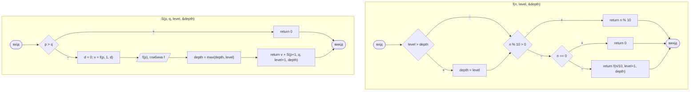
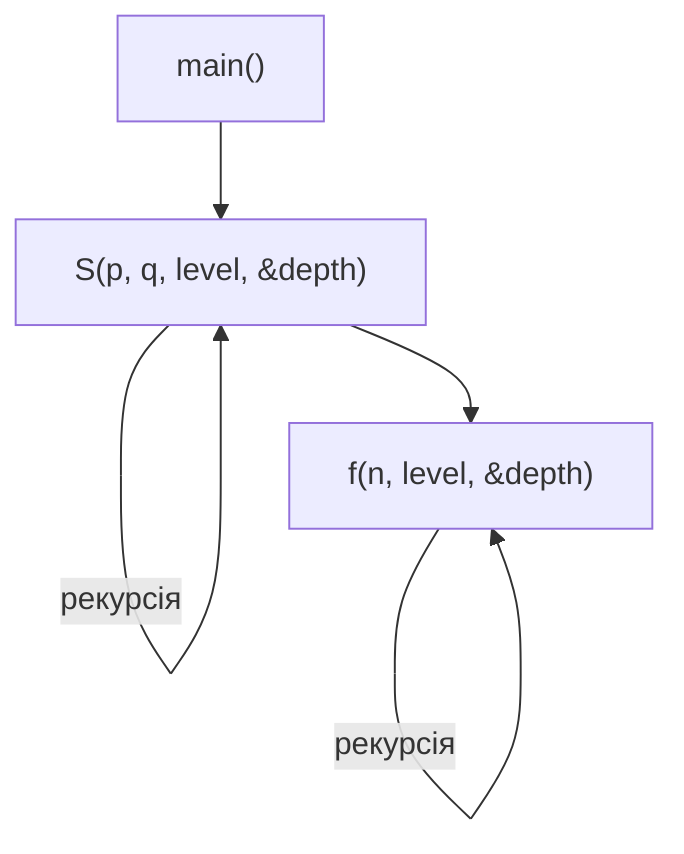

# ЗВІТ

про виконання лабораторної роботи № 5.5
«Рекурсивні функції»
з дисципліни «Алгоритмізація та програмування»
студента групи КН-2630б
**Турків Остап Миколайович**

---

## Умова завдання

Для всіх варіантів визначити та вивести глибину та рівень рекурсії.

**Варіант 33.** Рекурсивна функція f(n) визначена рекурентним співвідношенням:

```
        | n % 10,       якщо n % 10 > 0,
f(n) =  | 0,            якщо n = 0,
        | f(n / 10),    в іншому випадку
```

Визначити глибину рекурсії та обчислити функцію S(p, q) за даними p, q:

```
           q
S(p, q) = Σ  f(i)
          i=p
```

Тобто f(n) — це остання ненульова цифра числа n (наприклад, f(1200) = 2).

## Елементи рекурсії

- **Умова продовження:** `n % 10 == 0` і `n != 0`, тобто остання цифра дорівнює 0, а число ще не нульове.
- **Базові задачі:** `n % 10 > 0` → повернути `n % 10`; `n == 0` → повернути `0`.
- **Рекурсивний виклик:** `f(n / 10)` відкидає останню нульову цифру.

Рівень рекурсії передається параметром-значенням `level` і збільшується на 1 з кожним викликом. Глибина передається параметром-посиланням `depth`, який зберігає найбільший досягнутий рівень.

Функція `S(p, q)` теж реалізована рекурсивно: `S(p, q) = f(p) + S(p+1, q)`, базова задача: `p > q` → `0`.

## Блок-схеми функцій



## UML-діаграма дії функції f

```mermaid
flowchart TD
    F0((" ")) --> D0{" "}
    D0 -->|"[level > depth]"| F2("depth = level")
    D0 -->|"[else]"| J0{" "}
    F2 --> J0
    J0 --> D1{" "}
    D1 -->|"[n % 10 > 0]"| F4("return n % 10")
    D1 -->|"[else]"| D2{" "}
    D2 -->|"[n == 0]"| F6("return 0")
    D2 -->|"[else]"| F7("return f(n/10, level+1, depth)")
    F4 --> J{" "}
    F6 --> J
    F7 --> J
    J --> F9(((" ")))
    style F0 fill:#000
    style F9 fill:#000
```



## Структурна схема програми



## Приклад роботи (обчислено вручну)

```
p = 98, q = 102
  f(98)  = 8,  depth of f = 1
  f(99)  = 9,  depth of f = 1
  f(100) = 1,  depth of f = 3    (100 -> 10 -> 1)
  f(101) = 1,  depth of f = 1
  f(102) = 2,  depth of f = 1

S(98, 102) = 21
depth of S = 5
```

## Текст програми

Файл [Lab_5_5.cpp](Lab_5_5.cpp):

```cpp
// Lab_5_5.cpp
// Турків Остап Миколайович, група КН-2630б
// Лабораторна робота № 5.5
// Рекурсивні функції.
// Варіант 33
//
//         | n % 10,     якщо n % 10 > 0
// f(n) =  | 0,          якщо n == 0
//         | f(n / 10),  в іншому випадку
//
// S(p, q) = sum_{i=p}^{q} f(i)
// Визначити глибину та рівень рекурсії.

#include <iostream>

using namespace std;

// f(n) - остання ненульова цифра числа n
// level - поточний рівень рекурсії, depth - глибина (максимальний рівень)
int f(const int n, const int level, int &depth)
{
    if (level > depth)
        depth = level;

    if (n % 10 > 0)
        return n % 10;
    else
        if (n == 0)
            return 0;
        else
            return f(n / 10, level + 1, depth);
}

// S(p, q) - сума f(i) для i від p до q (також рекурсивно)
int S(const int p, const int q, const int level, int &depth)
{
    if (p > q)
        return 0;

    int d = 0; // глибина рекурсії для f(p)
    int value = f(p, 1, d);
    cout << "  f(" << p << ") = " << value << ",  depth of f = " << d << endl;
    if (level > depth)
        depth = level;

    return value + S(p + 1, q, level + 1, depth);
}

int main()
{
    int p, q;
    cout << "p = "; cin >> p;
    cout << "q = "; cin >> q;

    int depthS = 0;
    int result = S(p, q, 1, depthS);

    cout << endl;
    cout << "S(" << p << ", " << q << ") = " << result << endl;
    cout << "depth of S = " << depthS << endl;

    return 0;
}
```

## Посилання на git-репозиторій з проектом

<!--REPO:Lab_5_5-->

## Результати unit-тесту

Unit-тест виконано для функції лабораторної роботи № 5.1 (див. [Лабораторну роботу № 5.0](../Lab_5_0/README.md)).

## Висновки

Я навчився реалізовувати рекурсивні функції за рекурентним означенням і визначати рівень та глибину рекурсії. Рівень передається параметром-значенням, бо кожен виклик має свій рівень. Глибина передається параметром-посиланням, щоб усі виклики оновлювали одну й ту саму змінну. Глибина рекурсії функції f(n) дорівнює кількості нулів у кінці числа плюс 1, бо кожен рекурсивний виклик відкидає один кінцевий нуль.
